# PRAKTIKUM JARKOM MODUL 3 KELOMPOK K05 - 2026

## Anggota Kelompok

| Nama | NRP |
| --- | --- |
| Ronnin Raditya Putra Purbono | 5027251119 |
| Keisya Halimah Mulia | 5027251068 |

## Daftar Isi

- [Soal 1](#1-konfigurasi-ip-address-routing-nat-dan-konektivitas-dasar): Konfigurasi IP Address, Routing, NAT, dan Konektivitas Dasar
- [Soal 2](#2-instalasi-dan-konfigurasi-dhcp-server-pada-tengen): Instalasi dan Konfigurasi DHCP Server pada Tengen
- [Soal 3](#3-konfigurasi-dhcp-relay-pada-jichi): Konfigurasi DHCP Relay pada Jichi
- [Soal 4](#4-pembagian-dua-dhcp-pool-pada-network-2): Pembagian Dua DHCP Pool pada Network 2
- [Soal 5](#5-pengaturan-short-lease-dan-long-lease-pada-network-3): Pengaturan Short Lease dan Long Lease pada Network 3
- [Soal 6](#6-dhcp-static-lease-untuk-kugisaki): DHCP Static Lease untuk Kugisaki
- [Soal 7](#7-audit-ip-address-gateway-dns-dan-dhcp-lease): Audit IP Address, Gateway, DNS, dan DHCP Lease
- [Soal 8](#8-packet-capture-dan-analisis-proses-dhcp-dora): Packet Capture dan Analisis Proses DHCP DORA
- [Soal 9](#9-simulasi-gangguan-serta-pemulihan-dhcp-relay): Simulasi Gangguan serta Pemulihan DHCP Relay
- [Soal 10](#10-autostart-dhcp-server-dan-dhcp-relay-setelah-restart): Autostart DHCP Server dan DHCP Relay Setelah Restart
- [Soal 11](#11-dns-master-dan-slave): DNS Master dan Slave
- [Soal 12](#12-a-cname-ptr-dan-dns-forwarder): A, CNAME, PTR, dan DNS Forwarder
- [Soal 13](#13-replikasi-mariadb-yagainumaki): Replikasi MariaDB
- [Soal 14](#14-worker-frontend-dan-api): Worker frontend dan API
- [Soal 15](#15-weighted-round-robin-di-geto): Weighted Round Robin
- [Soal 16](#16-path-based-routing-di-gojo): Path-Based Routing
- [Soal 17](#17-pencatatan-ip-asli-klien): IP asli klien
- [Soal 18](#18-kirara-sebagai-cadangan-api): API cadangan
- [Soal 19](#19-cache-web-dan-rate-limit-api): Cache dan rate limit
- [Soal 20](#20-benchmark-dan-audit-access-log): Benchmark dan access log

### Informasi jaringan

| Parameter | Konfigurasi |
| --- | --- |
| Kelompok | K05 |
| Prefix IP internal | `10.66` |
| Subnet mask tiap segmen | `255.255.255.0` atau `/24` |
| Network 1 (DMZ) | `10.66.1.0/24`: gateway Jichi `10.66.1.1` |
| Network 2 (Divisi A) | `10.66.2.0/24`: gateway Jichi `10.66.2.1` |
| Network 3 (Divisi B) | `10.66.3.0/24`: gateway Jichi `10.66.3.1` |
| Network 4 (Data Center) | `10.66.4.0/24`: gateway Jichi `10.66.4.1` |
| Router / DHCP Relay | `jichi` |
| DHCP Server | `tengen`: `10.66.4.10` |
| DNS yang dibagikan DHCP | `10.66.1.2` (Utahime), `10.66.1.3` (Shoko) |
| Domain search | `k05.com` |
| WAN NAT GNS3 | Interface `jichi:eth0`, gateway `192.168.122.1` |
| Lokasi skrip pada node | Direktori `/root` |
| Image node server/router | `ardhptr21/debinet:latest` |
| Image node client | `ardhptr21/alpinet:latest` |

### Tabel subnet dan alamat yang dipakai

| Segmen | Jaringan / mask | Gateway Jichi | Node dan alamat yang dibuktikan | Alokasi |
| --- | --- | --- | --- | --- |
| WAN NAT | Alamat dari NAT GNS3 | `192.168.122.1` | `jichi:eth0` menerima alamat otomatis | Jalur keluar internet; alamat WAN bisa berubah. |
| Network 1, DMZ | `10.66.1.0/24`, `255.255.255.0` | `10.66.1.1` (`eth1`) | Utahime `.2`, Shoko `.3`, Gojo `.4` | Server statis dan pintu masuk domain. |
| Network 2, Divisi A | `10.66.2.0/24`, `255.255.255.0` | `10.66.2.1` (`eth2`) | Itadori `.10`, Fushiguro `.11`, Zenin `.70`, Okkotsu `.71` | DHCP Pool 1 `.10` sampai `.35`; Pool 2 `.70` sampai `.95`; `.36` sampai `.69` tidak dialokasikan. |
| Network 3, Divisi B | `10.66.3.0/24`, `255.255.255.0` | `10.66.3.1` (`eth3`) | Ino `.10`, Kusakabe `.11`, Kugisaki `.99`, Miwa `.100` | Short lease `.10` sampai `.89` (1800 detik), reservasi `.99`, long lease `.100` sampai `.199` (43200 detik). |
| Network 4, Data Center | `10.66.4.0/24`, `255.255.255.0` | `10.66.4.1` (`eth4`) | Geto `.2`, Maki `.3`, Panda `.4`, Nanami `.5`, Todo `.6`, Kirara `.7`, Yaga `.8`, Inumaki `.9`, Tengen `.10` | Server statis; tidak ada pool DHCP dinamis di segmen ini. |

Keempat LAN memakai broadcast `10.66.1.255`, `10.66.2.255`, `10.66.3.255`, dan `10.66.4.255` menurut nomor segmennya. Alamat host klien pada tabel adalah hasil yang terlihat saat pengujian. DHCP dapat memberi alamat berbeda bila lease atau identitas klien berubah; yang tetap dinilai adalah subnet, pool, gateway, DNS, dan kelas lease. DNS klien adalah Utahime `10.66.1.2` dan Shoko `10.66.1.3`, dengan search domain `k05.com`.

**TOPOLOGY**


---

# 1. Konfigurasi IP Address, Routing, NAT, dan Konektivitas Dasar

## Soal

> Ketika Curtain menutup Shibuya, jalur komunikasi antar zona Jujutsu High terputus. Pulihkan konektivitas dasar dengan mengonfigurasi jichi: eth0 memperoleh WAN dari NAT, sedangkan eth1–eth4 menjadi gateway Network 1–4 sesuai tabel pemetaan. Aktifkan IPv4 forwarding dan source NAT, lalu tetapkan IP statis host infrastruktur sesuai tabel spesifikasi. Buktikan konektivitas setiap host ke gateway dan akses eksternal dari host yang relevan.

Saya menyiapkan Jichi sebagai gateway empat LAN dan NAT ke WAN. Di materi routing dan Source NAT, `ip_forward` memungkinkan paket melewati Jichi, sedangkan MASQUERADE mengganti alamat sumber ketika paket keluar lewat `eth0`.

## Alasan konfigurasi routing dan NAT

| Bagian skrip/konfigurasi | Fungsi | Alasan digunakan |
| --- | --- | --- |
| `ip link set <interface> up` | Mengaktifkan antarmuka | IP yang telah diatur tidak bermanfaat bila link tidak aktif. |
| `ip addr add` / `ip addr replace` | Mengatur IPv4 dan prefix `/24` | Memisahkan empat domain broadcast dan memastikan seluruh host memakai segmentasi yang tepat. |
| `ip route` | Memeriksa/mengatur rute termasuk default gateway | Host internal perlu mengirim trafik lintas-subnet melalui Jichi; Jichi mengirim trafik eksternal ke NAT. |
| `sysctl -w net.ipv4.ip_forward=1` | Mengaktifkan forwarding | Kernel harus diizinkan meneruskan paket antar-interface, bukan hanya menerima paket untuk Jichi sendiri. |
| `iptables -t nat ... MASQUERADE` | Source NAT keluar melalui `eth0` | Alamat privat `10.66.x.x` perlu diterjemahkan saat mencapai jaringan luar. |
| `ping` ke gateway atau `8.8.8.8` | Uji konektivitas Layer 3 | Membuktikan akses gateway lokal dan koneksi internet berbasis IP tanpa bergantung pada DNS. |

## Analisis Kebutuhan dan Skema Jaringan

Soal menggabungkan tiga hal yang saling bergantung: pengalamatan IP, routing antarsubnet, dan akses internet melalui NAT. Sesuai rancangan, `jichi` mempunyai lima interface: satu interface menuju NAT (`eth0`) dan empat interface sebagai gateway tiap jaringan internal (`eth1` sampai `eth4`). Client tidak perlu memiliki tabel routing untuk semua subnet, karena cukup memakai default gateway yang merupakan IP Jichi pada segmennya.

### Pembagian interface dan gateway Jichi

| Interface Jichi | Segmen | IP gateway |
| --- | --- | --- |
| `eth0` | WAN/NAT GNS3 | IP WAN dari NAT; next hop `192.168.122.1` |
| `eth1` | Network 1 / DMZ | `10.66.1.1/24` |
| `eth2` | Network 2 / Divisi A | `10.66.2.1/24` |
| `eth3` | Network 3 / Divisi B | `10.66.3.1/24` |
| `eth4` | Network 4 / Data Center | `10.66.4.1/24` |

### Host infrastruktur statis yang dibuktikan

| Host | IP Address | Default gateway | Peran |
| --- | --- | --- | --- |
| `utahime` | `10.66.1.2/24` | `10.66.1.1` | DNS Master, Network 1 |
| `shoko` | `10.66.1.3/24` | `10.66.1.1` | DNS Slave, Network 1 |
| `tengen` | `10.66.4.10/24` | `10.66.4.1` | DHCP Server, Network 4 |

Alamat `jichi:eth0` diberikan oleh NAT melalui DHCP. Karena dapat berubah menurut lingkungan GNS3, laporan ini tidak mengunci satu angka IP WAN; yang relevan ialah bahwa interface berada di segmen `192.168.122.0/24` dan default route menuju `192.168.122.1`.

## Perintah yang saya jalankan

Perintah berlabel setup mengubah konfigurasi atau layanan; perintah berlabel cek hanya membaca status dan hasilnya. Skrip gabungan di repository adalah dokumentasi yang perlu dicocokkan dengan keadaan node sebelum dijalankan ulang.

Untuk nama skrip per-node, jalankan `sh /root/soal1-<nama-node>.sh` pada Jichi, Utahime, Shoko, Tengen, Gojo, Geto, Inumaki, Nanami, Kirara, Panda, dan Todo. Contoh: `sh /root/soal1-jichi.sh`.

**Node:** Jichi, Utahime, Shoko, Tengen, Gojo, Geto, Inumaki, Nanami, Kirara, Panda, dan Todo. Jalankan skrip **di terminal masing-masing node GNS3**, bukan di PowerShell komputer lokal.

**Langkah 1: Pastikan file skrip untuk node yang sesuai sudah berada di `/root`.**

**Langkah 2: Konfigurasi router Jichi.**

```sh
sh /root/soal1-jichi.sh
```

Skrip menangani WAN DHCP, IP gateway empat network, IPv4 forwarding, dan source NAT. **Ekspektasi:** `eth1` sampai `eth4` masing-masing `10.66.1.1/24` sampai `10.66.4.1/24` dan internet dapat dijangkau.

**Langkah 3: Konfigurasi setiap node infrastruktur.** Jalankan masing-masing *hanya* pada node yang sesuai.

| Node | Command | IP dan gateway yang diharapkan |
| --- | --- | --- |
| Utahime | `sh /root/soal1-utahime.sh` | `10.66.1.2/24`, gateway `10.66.1.1` |
| Shoko | `sh /root/soal1-shoko.sh` | `10.66.1.3/24`, gateway `10.66.1.1` |
| Tengen | `sh /root/soal1-tengen.sh` | `10.66.4.10/24`, gateway `10.66.4.1` |

**Langkah 4: Verifikasi Jichi.**

```bash
ip -br addr
ip route
sysctl net.ipv4.ip_forward
iptables -t nat -L POSTROUTING -n -v
ping -c 3 8.8.8.8
```

**Ekspektasi:** `net.ipv4.ip_forward = 1`, ada aturan `MASQUERADE` menuju `eth0`, dan ping internet berhasil. Pada Utahime/Shoko/Tengen, periksa `ip -br addr`, `ip route`, dan `ping -c 3 <IP-gateway-masing-masing>`.

**Jika gagal:** cek apakah `eth0` Jichi menerima IP NAT dan route default, kemudian pastikan gateway host mengarah ke IP Jichi pada network yang sama.

**Konfigurasi setelah setup:** Jichi memiliki `eth1` sampai `eth4` sebagai gateway `.1`, IPv4 forwarding aktif, dan NAT keluar `eth0`. Server statis memakai gateway pada segmennya.

## Hasil pengujian

Bukti Jichi menampilkan interface internal yang mengikuti rencana pengalamatan, routing, forwarding, NAT, dan ping keluar yang berhasil. Bukti pada Utahime, Shoko, serta Tengen menunjukkan gateway masing-masing dan konektivitas IP berhasil. Ini penting karena server DHCP pada nomor berikutnya akan diletakkan di Network 4, sedangkan request berasal dari Network 2 dan 3.

## Bukti hasil

### Foto 1: Jichi: konfigurasi jaringan dan akses internet

Menunjukkan status interface router, routing, forwarding/NAT, serta pengujian koneksi keluar.


Jichi berfungsi sebagai titik pertemuan empat LAN dan satu WAN NAT; keberhasilan ping IP publik mengindikasikan jalur eksternal tersedia.

### Foto 2: Jichi: verifikasi routing dan NAT

Tangkapan layar lanjutan konfigurasi Jichi untuk menguatkan hasil pemeriksaan di router.

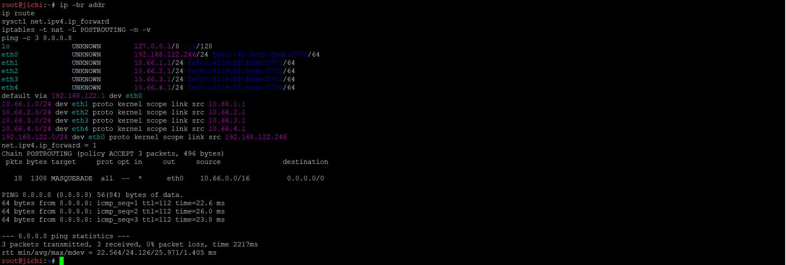

Adanya rute lokal untuk empat subnet dan aturan keluar diperlukan sebelum layanan lintas jaringan diuji.

### Foto 3: Utahime: IP, gateway, dan konektivitas

Memuat pemeriksaan IP host `utahime` dan uji gateway/internet.

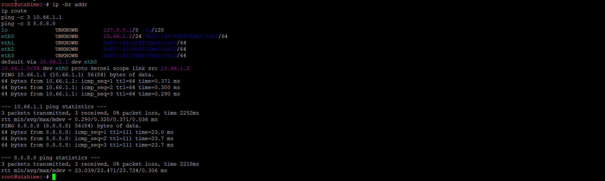

Utahime berada di Network 1, yaitu subnet `10.66.1.0/24` dengan next hop `10.66.1.1`.

### Foto 4: Shoko: IP, gateway, dan konektivitas

Memuat pemeriksaan IP host `shoko` dan uji gateway/internet.

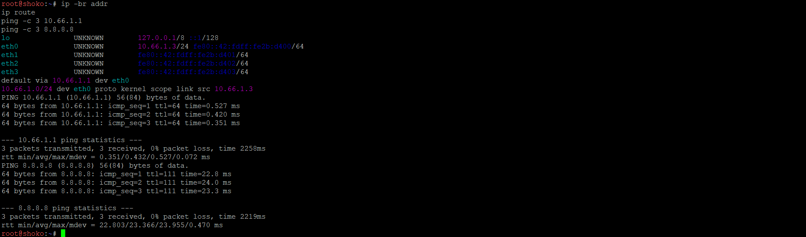

Shoko menggunakan subnet DMZ yang sama dengan Utahime, tetapi memiliki IP berbeda agar tidak bentrok.

### Foto 5: Tengen: IP, gateway, dan konektivitas

Memuat pemeriksaan IP host `tengen` dan uji gateway/internet.

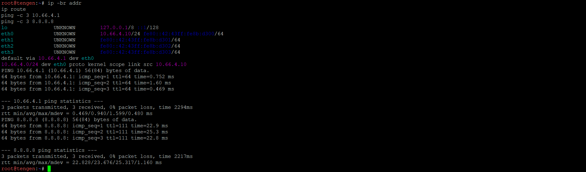

Tengen berada pada `10.66.4.10/24`; keterjangkauan Network 4 dibutuhkan agar Jichi dapat meneruskan paket DHCP ke server.

## Hasil

Routing dasar pada Jichi, penetapan IP statis host infrastruktur, pengaktifan forwarding, dan source NAT telah diverifikasi dengan bukti akses gateway dan koneksi eksternal. Kondisi ini menjadi prasyarat untuk mendukung layanan DHCP lintas subnet pada nomor selanjutnya.

---

# 2. Instalasi dan Konfigurasi DHCP Server pada Tengen

## Soal

> Tengen, penjaga pusat distribusi di Data Center, harus mengambil alih pengalokasian alamat bagi wilayah yang membutuhkan konfigurasi dinamis. Konfigurasikan isc-dhcp-server pada [PREFIX IP].4.10. Deklarasikan Network 4 ([PREFIX IP].4.0/24) sebagai subnet lokal tanpa pool dinamis, lalu siapkan scope DHCP untuk Network 2 ([PREFIX IP].2.0/24) dan Network 3 ([PREFIX IP].3.0/24). Validasi konfigurasi dan pastikan service aktif tanpa error “No subnet declaration”.

Saya menyiapkan Tengen sebagai DHCP Server. Materi DHCP Server menjelaskan bahwa subnet tempat server berada tetap harus dideklarasikan walau tidak memiliki pool; deklarasi itu membuat daemon mengenali `eth0` pada Network 4.

## Alasan konfigurasi DHCP Server

| Bagian konfigurasi | Fungsi | Alasan |
| --- | --- | --- |
| `isc-dhcp-server` | Daemon pembagi konfigurasi IP secara dinamis | Tengen menjadi pusat distribusi DHCP untuk Divisi A dan Divisi B. |
| `INTERFACESv4="eth0"` | Memilih interface yang mendengarkan DHCP | Tengen hanya mempunyai interface layanan di Data Center. |
| Deklarasi `subnet 10.66.4.0/24` tanpa `range` | Mengenalkan subnet tempat server berdiri | Menghindari error `No subnet declaration for eth0` dan mencegah distribusi dinamis pada Data Center. |
| Deklarasi `subnet 10.66.2.0/24` dan `10.66.3.0/24` | Menyediakan scope subnet klien remote | Server harus tahu subnet tujuan ketika request diteruskan oleh DHCP Relay. |
| `dhcpd -t -cf /etc/dhcp/dhcpd.conf` | Menguji validitas konfigurasi | Syntax error dicegah sebelum service dijalankan. |
| `ss -lunp` | Memeriksa UDP port 67 | Membuktikan daemon benar-benar siap menerima paket DHCP. |

## Penjelasan dan Alur Kerja DHCP Server

Tengen adalah node Data Center `10.66.4.10`. Tidak semua client berada satu segmen dengan Tengen. Oleh karena itu server harus mendefinisikan subnet **lokal** `10.66.4.0/24` sekaligus dua subnet **remote** `10.66.2.0/24` dan `10.66.3.0/24`. Pembagian rentang alamat per kelas dilakukan lebih rinci pada Soal 4 dan Soal 5.

`isc-dhcp-server` menggunakan UDP 67 untuk menerima request, sementara client memakai UDP 68. Agar server tidak salah membaca interface lokal, `INTERFACESv4` diset ke `eth0`. Network 4 sengaja tidak mendapat pool karena Data Center menggunakan pengalamatan statis sesuai desain.

## Perintah yang saya jalankan

Perintah berlabel setup mengubah konfigurasi atau layanan; perintah berlabel cek hanya membaca status dan hasilnya. Skrip gabungan di repository adalah dokumentasi yang perlu dicocokkan dengan keadaan node sebelum dijalankan ulang.

Jalankan skrip per-node `sh /root/soal2-tengen.sh` pada Tengen.

**Node:** `tengen`. Pastikan Soal 1 selesai terlebih dahulu.

**Langkah 1: Jalankan skrip instalasi dan konfigurasi DHCP.**

```sh
sh /root/soal2-tengen.sh
```

Skrip memasang `isc-dhcp-server`, memilih `eth0`, dan mendeklarasikan Network 2, 3, serta Network 4 (tanpa pool dinamis di Network 4).

**Langkah 2: Validasi file konfigurasi dan status daemon.**

```bash
dhcpd -t -cf /etc/dhcp/dhcpd.conf
service isc-dhcp-server status
pgrep -a dhcpd
ss -lunp | grep ':67'
```

**Ekspektasi:** konfigurasi valid, status `dhcpd is running`, proses `dhcpd` muncul, dan UDP port `67` terbuka. Tidak ada error `No subnet declaration`.

**Langkah 3: Periksa subnet.**

```bash
grep -n 'subnet 10.66' /etc/dhcp/dhcpd.conf
```

**Ekspektasi:** deklarasi `10.66.2.0`, `10.66.3.0`, dan `10.66.4.0`. Jika server belum aktif, periksa hasil `dhcpd -t` sebelum mencoba restart.

> **Perhatian:** skrip Soal 2 menulis konfigurasi dasar DHCP. Jika pool Soal 4–6 sudah dipasang, **jangan jalankan ulang skrip Soal 2** karena dapat menimpa konfigurasi akhir.

**Konfigurasi setelah setup:** Tengen mendengarkan di `eth0:67`; deklarasi Network 4 tanpa pool dan scope Network 2 serta 3 ada di `dhcpd.conf`.

## Hasil pengujian

Foto menampilkan service DHCP dalam keadaan berjalan, proses `dhcpd`, dan listener di port 67. Cuplikan file konfigurasi memuat Network 4 tanpa pool, Network 2, dan Network 3 beserta gateway dan opsi DNS yang relevan. Server siap menerima request yang akan diteruskan oleh Jichi.

## Bukti hasil

### Foto 1: Tengen: DHCP Server aktif dan port UDP 67

Menunjukkan status proses layanan DHCP dan socket yang mendengarkan port 67.

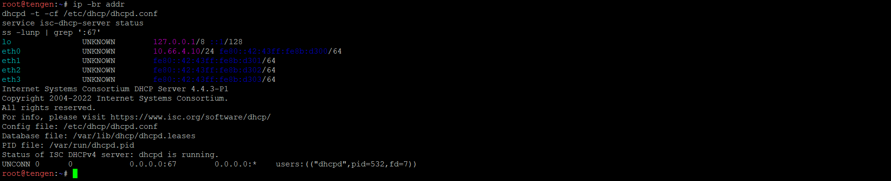

Status layanan berjalan dan port tersedia merupakan dua bukti berbeda: konfigurasi valid saja belum menjamin daemon benar-benar aktif.

### Foto 2: Tengen: konfigurasi subnet Network 2, 3, dan 4

Tangkapan isi `dhcpd.conf` yang memperlihatkan deklarasi subnet sesuai topologi.

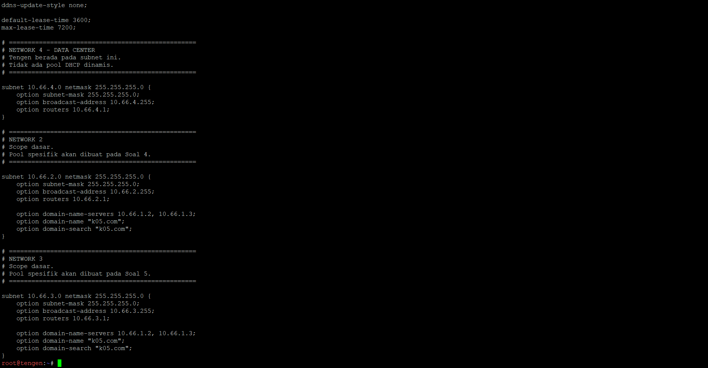

Network 4 harus dideklarasikan tanpa range agar server mengenali LAN sendiri, sedangkan Network 2/3 disiapkan untuk request melalui relay.

## Hasil

Server DHCP terpusat di Tengen berhasil dipersiapkan dan diuji, mencakup deklarasi subnet yang benar, status layanan aktif, dan port DHCP yang tersedia. Tahap ini menjadi fondasi bagi pengalokasian alamat lintas-subnet.

---

# 3. Konfigurasi DHCP Relay pada Jichi

## Soal

> Permintaan alamat dari Divisi A dan Divisi B tidak dapat menyeberangi subnet secara langsung. Konfigurasikan jichi sebagai DHCP Relay menuju tengen ([PREFIX IP].4.10), menggunakan eth2 untuk Network 2 dan eth3 untuk Network 3. Buktikan bahwa client dari kedua subnet berhasil memperoleh lease melalui relay.

Saya menjalankan DHCP Relay di Jichi karena broadcast DHCP dari Network 2 dan 3 tidak melintasi router sendiri. Relay mengisi `giaddr` agar Tengen memilih scope yang sesuai dengan subnet asal.

## Alasan konfigurasi DHCP Relay

| Bagian | Fungsi | Alasan |
| --- | --- | --- |
| `isc-dhcp-relay` / `dhcrelay` | Meneruskan DHCP broadcast antar-subnet | Broadcast Discover tidak melewati router secara biasa. |
| `SERVERS="10.66.4.10"` | Menunjuk alamat Tengen | Semua permintaan alamat dikirim ke satu server pusat. |
| `INTERFACES="eth2 eth3 eth4"` | Mendengarkan sisi client dan server | `eth2` ke Network 2, `eth3` ke Network 3, `eth4` ke Data Center. |
| `pgrep -a dhcrelay` | Memeriksa proses dan argumen aktual | Memastikan relay berjalan menuju tujuan serta interface yang tepat. |
| Field `giaddr` pada request DHCP | Penanda jaringan asal relay | Membantu server memilih scope Network 2 atau Network 3. |

## Penjelasan Teknis

DHCP Discover dikirim client sebagai broadcast. Karena client Itadori/Fushiguro/Zenin/Okkotsu berada di Network 2 dan Ino/Kusakabe/Miwa/Kugisaki berada di Network 3, permintaan mereka tidak langsung mencapai Tengen di Network 4. Jichi memerlukan **DHCP Relay** yang menerima permintaan pada interface segmen asal, kemudian meneruskannya ke `10.66.4.10`.

Relay mengisi alamat gateway relay (`giaddr`) sesuai segmen asal. Sebagai contoh ketika Itadori di Network 2 meminta alamat, relay pada interface `eth2` merepresentasikan jaringan `10.66.2.0/24` dengan `giaddr = 10.66.2.1`. Tengen memakai nilai ini untuk memilih subnet dan pool yang benar, lalu jawaban kembali melalui relay.

## Perintah yang saya jalankan

Perintah berlabel setup mengubah konfigurasi atau layanan; perintah berlabel cek hanya membaca status dan hasilnya. Skrip gabungan di repository adalah dokumentasi yang perlu dicocokkan dengan keadaan node sebelum dijalankan ulang.

Jalankan skrip per-node `sh /root/soal3-jichi.sh` pada Jichi.

**Node:** `jichi`, lalu verifikasi dari salah satu client Network 2/3.

**Langkah 1: Jalankan konfigurasi relay.**

```sh
sh /root/soal3-jichi.sh
```

**Langkah 2: Pastikan relay mengarah ke Tengen.**

```bash
cat /etc/default/isc-dhcp-relay
pgrep -a dhcrelay
```

**Ekspektasi:** `SERVERS="10.66.4.10"`, interface `eth2 eth3 eth4`, dan proses `dhcrelay` berjalan menuju `10.66.4.10`.

**Langkah 3: Uji dari client yang telah memiliki konfigurasi pool.**

```sh
udhcpc -i eth0 -q -n
ip -br addr show eth0
ip route
```

**Ekspektasi:** client Network 2 menerima `10.66.2.x/24` dan gateway `10.66.2.1`; Network 3 menerima `10.66.3.x/24` dan gateway `10.66.3.1`. Jangan menjalankan pengujian ini sebelum pool masing-masing tersedia.

**Jika gagal:** pastikan server DHCP Tengen aktif dan proses relay memasang interface yang tepat.

**Konfigurasi setelah setup:** Jichi menjalankan `dhcrelay` pada sisi Network 2/3 dan meneruskan permintaan ke Tengen `10.66.4.10`.

## Hasil pengujian

Jichi memiliki konfigurasi relay menuju Tengen dengan interface `eth2 eth3 eth4`. Kombinasi ini diperlukan agar trafik DHCP dari dua jaringan klien mencapai server di Data Center. Keberhasilan lease di Network 2 dan 3 pada nomor-nomor berikutnya menjadi verifikasi end-to-end alur relay, bukan hanya verifikasi status daemon.

## Bukti hasil

### Foto 1: Jichi: konfigurasi DHCP Relay dan proses aktif

Memperlihatkan isi berkas konfigurasi relay serta proses yang mengarah ke `10.66.4.10`.

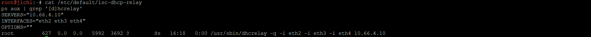

Kesesuaian interface menentukan apakah relay menerima Discover dari subnet klien yang tepat dan dapat mengirim ke jaringan server.

## Hasil

Jichi menjalankan fungsi DHCP Relay menuju Tengen dan menghubungkan dua subnet client dengan server DHCP terpusat di Network 4. Konfigurasi ini menjadi syarat distribusi lease berdasarkan kelas klien.

---

# 4. Pembagian Dua DHCP Pool pada Network 2

## Soal

> Agar tim Dev dan Support di Divisi A menerima jatah alamat yang berbeda, atur dua pool DHCP pada Network 2. Tetapkan Pool 1 ([PREFIX IP].2.10–[PREFIX IP].2.35) untuk itadori dan fushiguro, serta Pool 2 ([PREFIX IP].2.70–[PREFIX IP].2.95) untuk zenin dan okkotsu. Rentang [PREFIX IP].2.36–[PREFIX IP].2.69 tidak boleh dialokasikan. Karena seluruh client berada pada subnet yang sama, gunakan DHCP class berdasarkan MAC Address atau Client ID untuk memisahkan kedua kelompok.

Saya membedakan dua DHCP pool pada Network 2 memakai DHCP class berdasarkan identitas klien. Karena semua klien berada dalam satu subnet, alamat subnet saja tidak dapat membedakan tim Dev dan Support.

## Pembagian kelas dan pool DHCP

| Ketentuan | Tujuan | Alasan |
| --- | --- | --- |
| Pool 1 `.2.10–.2.35` | IP khusus Itadori dan Fushiguro | Kedua client tergabung dalam Divisi A kelompok pertama. |
| Pool 2 `.2.70–.2.95` | IP khusus Zenin dan Okkotsu | Kedua client mendapat ruang alamat berbeda meskipun satu subnet. |
| Larangan `.2.36–.2.69` | Rentang tidak boleh diberikan | Mencegah pool melampaui kebijakan alamat yang ditentukan. |
| DHCP class berdasarkan MAC/Client ID | Membedakan request dalam subnet yang sama | Alamat `giaddr` tidak dapat membedakan kelompok, karena keempat client berada di Network 2. |
| `allow members of ...` | Membatasi anggota yang bisa memakai suatu pool | Menjamin anggota Pool 1 tidak menerima alamat Pool 2, begitu pula sebaliknya. |

## Analisis Kebijakan Alokasi Network 2

Network 2 mempunyai alamat subnet `10.66.2.0/24` dengan gateway `10.66.2.1`, broadcast `10.66.2.255`, serta DNS `10.66.1.2` dan `10.66.1.3`. Karena keempat client berada di segmen broadcast yang sama, pemisahan pool tidak dapat mengandalkan interface relay saja. Pembagian dilakukan melalui identitas client seperti MAC address atau Client ID.

### Identitas MAC dan hasil alokasi

| Client | MAC yang dicatat | Pool | IP hasil pengujian | Gateway |
| --- | --- | --- | --- | --- |
| `itadori` | `02:42:82:1c:22:00` | Pool 1 | `10.66.2.10/24` | `10.66.2.1` |
| `fushiguro` | `02:42:f2:4f:86:00` | Pool 1 | `10.66.2.11/24` | `10.66.2.1` |
| `zenin` | `02:42:75:8d:2f:00` | Pool 2 | `10.66.2.70/24` | `10.66.2.1` |
| `okkotsu` | `02:42:3a:94:86:00` | Pool 2 | `10.66.2.71/24` | `10.66.2.1` |

**Penting:** nilai IP pada tabel merupakan hasil lease yang tampak pada bukti, bukan `fixed-address` untuk semua client. Lease dapat berbeda setelah database lease dibersihkan, selama tetap dalam pool yang diizinkan.

## Perintah yang saya jalankan

Skrip gabungan nomor ini hanya dipakai untuk pemeriksaan. Setup yang menghasilkan konfigurasi atau paket pada foto dijelaskan pada langkah praktikum, dan saya tidak mengklaim skrip rekonstruksi sebagai salinan perintah lama.

Jalankan skrip per-node `sh /root/soal4-tengen.sh` pada Tengen.

**Node konfigurasi:** `tengen`. **Node uji:** `itadori`, `fushiguro`, `zenin`, `okkotsu`.

**Langkah 1: Periksa kebijakan pool yang sudah dikonfigurasi pada Tengen.**

```sh
sh /root/soal4-tengen.sh
```

> Skrip Soal 4 hanya memeriksa konfigurasi. Agar hasilnya sama dengan foto, kelas dan kedua pool harus sudah ada di `/etc/dhcp/dhcpd.conf` pada Tengen.

**Langkah 2: Pastikan konfigurasi valid dan server berjalan.**

```bash
dhcpd -t -cf /etc/dhcp/dhcpd.conf
service isc-dhcp-server status
```

**Langkah 3: Minta lease dari masing-masing client** (jalankan pada terminal client yang bersangkutan).

```sh
udhcpc -i eth0 -q -n
ip -br addr show eth0
ip route
```

**Ekspektasi hasil:**

| Client | Kelompok | IP yang terdokumentasi | Gateway |
| --- | --- | --- | --- |
| Itadori | Pool 1 | `10.66.2.10/24` | `10.66.2.1` |
| Fushiguro | Pool 1 | `10.66.2.11/24` | `10.66.2.1` |
| Zenin | Pool 2 | `10.66.2.70/24` | `10.66.2.1` |
| Okkotsu | Pool 2 | `10.66.2.71/24` | `10.66.2.1` |

Pool 1 memiliki rentang `.10–.35`, Pool 2 `.70–.95`, dan `.36–.69` tidak boleh teralokasi. Angka IP per client di tabel merupakan hasil yang terlihat pada dokumentasi, bukan jaminan urutan alokasi baru.

**Konfigurasi setelah setup:** Tengen memiliki dua pool Network 2, `.10` sampai `.35` dan `.70` sampai `.95`, dipisahkan berdasarkan kelas klien. Skrip gabungan soal 4 hanya mengeceknya.

## Hasil pengujian

Berdasarkan empat bukti client, distribusi alamat sesuai kebijakan: Itadori dan Fushiguro berada pada rentang Pool 1, sedangkan Zenin dan Okkotsu berada pada rentang Pool 2. File konfigurasi Tengen menunjukkan pembagian kelas/pool yang mengikat alokasi. Kombinasi bukti sisi server dan sisi client mendukung bahwa pembatasan berjalan sesuai tujuan.

## Bukti hasil

### Foto 1: Tengen: DHCP class dan dua pool Network 2

Memperlihatkan pembagian kelas client berdasarkan identitas dan penetapan rentang dua pool.

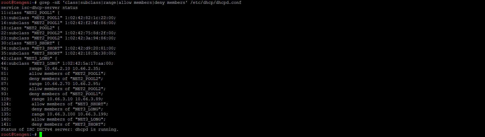

Rentang antar-pool tidak saling bersinggungan dan menyisakan ruang `.36–.69` tanpa alokasi dinamis.

### Foto 2: Fushiguro menerima lease Pool 1

Menunjukkan `10.66.2.11/24` dengan default gateway `10.66.2.1`.

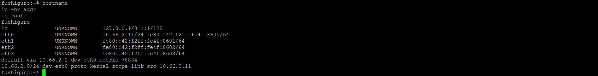

IP berada di `10.66.2.10–.35`, sehingga sesuai kategori Pool 1.

### Foto 3: Itadori menerima lease Pool 1

Menunjukkan `10.66.2.10/24` dengan default gateway `10.66.2.1`.

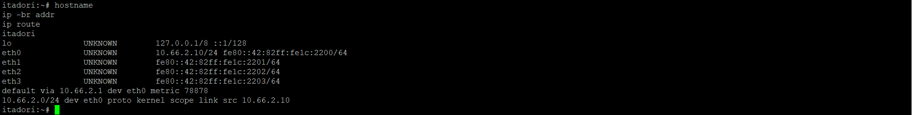

Bukti klien kedua pada kelas yang sama menunjukkan alokasi dilakukan tanpa konflik IP.

### Foto 4: Zenin menerima lease Pool 2

Menunjukkan `10.66.2.70/24` dengan default gateway `10.66.2.1`.

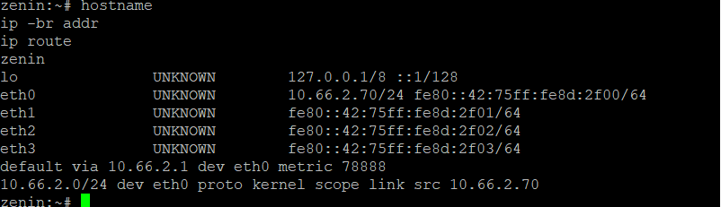

Nilai berada tepat pada awal rentang Pool 2, bukan Pool 1.

### Foto 5: Okkotsu menerima lease Pool 2

Menunjukkan `10.66.2.71/24` dengan default gateway `10.66.2.1`.

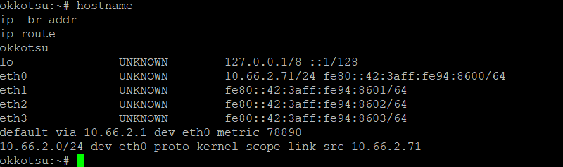

Alokasi Pool 2 berjalan untuk lebih dari satu MAC dan tidak memakai rentang terlarang.

## Hasil

Pemisahan DHCP berdasarkan identitas client pada Network 2 sesuai dua kebijakan pool. Empat client memperoleh alamat dalam rentang yang benar dan menggunakan gateway Network 2 yang sama.

---

# 5. Pengaturan Short Lease dan Long Lease pada Network 3

## Soal

> Setiap tim lapangan memiliki durasi operasi yang berbeda. Pada Network 3, berikan short lease 30 menit (1800 detik) kepada ino dan kusakabe, serta long lease 12 jam (43200 detik) kepada miwa. Gunakan pool short lease [PREFIX IP].3.10–[PREFIX IP].3.89 dan pool long lease [PREFIX IP].3.100–[PREFIX IP].3.199. Sesuaikan default-lease-time dan max-lease-time untuk setiap kelas client. Berikan pula DHCP options berupa DNS [PREFIX IP].1.2 dan [PREFIX IP].1.3, serta domain-search <xxxx>.com.

Saya memakai kelas DHCP yang berbeda pada Network 3 agar Ino dan Kusakabe memperoleh lease 1800 detik, sedangkan Miwa memperoleh 43200 detik. Kedua durasi tetap menggunakan gateway dan DNS Network 3 yang sama.

## Durasi lease pada Network 3

| Pengaturan | Nilai | Tujuan |
| --- | --- | --- |
| Short lease | `1800` detik = 30 menit | Mempercepat daur ulang alamat untuk tim dengan koneksi sementara. |
| Long lease | `43200` detik = 12 jam | Mengurangi kebutuhan renewal untuk terminal yang perlu stabilitas lebih lama. |
| Pool short | `10.66.3.10–10.66.3.89` | Menampung Ino dan Kusakabe. |
| Pool long | `10.66.3.100–10.66.3.199` | Menampung Miwa. |
| `default-lease-time` | Lease default yang ditawarkan | Menentukan lama sewa normal jika client tidak meminta nilai lain. |
| `max-lease-time` | Batas atas lease | Menjaga request durasi lease tidak melewati kebijakan pool. |
| DHCP option DNS + domain search | Utahime, Shoko, `k05.com` | Membentuk konfigurasi resolusi nama yang konsisten. |

## Analisis Kebutuhan Network 3

Network 3 memiliki gateway `10.66.3.1/24`, broadcast `10.66.3.255`, dan dua kelas lease yang berbeda. Pemisahan berdasarkan kelas client memastikan Ino serta Kusakabe memperoleh lease singkat, sementara Miwa memiliki lease panjang. Subnet tetap sama; yang berbeda adalah rentang pool dan durasi sewa.

### Alokasi yang terverifikasi

| Client | Kebijakan | Pool | IP hasil | Gateway |
| --- | --- | --- | --- | --- |
| `ino` | Short lease 1800 detik | `.3.10–.3.89` | `10.66.3.10/24` | `10.66.3.1` |
| `kusakabe` | Short lease 1800 detik | `.3.10–.3.89` | `10.66.3.11/24` | `10.66.3.1` |
| `miwa` | Long lease 43200 detik | `.3.100–.3.199` | `10.66.3.100/24` | `10.66.3.1` |

## Perintah yang saya jalankan

Skrip gabungan nomor ini hanya dipakai untuk pemeriksaan. Setup yang menghasilkan konfigurasi atau paket pada foto dijelaskan pada langkah praktikum, dan saya tidak mengklaim skrip rekonstruksi sebagai salinan perintah lama.

Pada Tengen jalankan `sh /root/soal5-tengen.sh`; pada Miwa jalankan `sh /root/soal5-miwa.sh`.

**Node konfigurasi:** `tengen`. **Node uji:** `ino`, `kusakabe`, `miwa`.

**Langkah 1: Periksa pool dan parameter lease yang sudah ada.**

```sh
sh /root/soal5-tengen.sh
```

> Skrip Tengen hanya memeriksa konfigurasi. Pool short dan long harus sudah tersedia sebelum audit Miwa.

**Langkah 2: Verifikasi syntax DHCP.**

```bash
dhcpd -t -cf /etc/dhcp/dhcpd.conf
service isc-dhcp-server status
```

**Langkah 3: Jalankan pada Ino, Kusakabe dan Miwa secara bergantian.**

```sh
udhcpc -i eth0 -q -n
ip -br addr show eth0
ip route
cat /etc/resolv.conf
```

Pada Miwa jalankan skrip khusus:

```sh
sh /root/soal5-miwa.sh
```

**Ekspektasi:** Ino (`10.66.3.10`) dan Kusakabe (`10.66.3.11`) masuk pool `.10–.89` dengan waktu lease **1800 detik**; Miwa (`10.66.3.100`) masuk pool `.100–.199` dengan lease **43200 detik**. Semua menggunakan gateway `10.66.3.1`, DNS `10.66.1.2`, `10.66.1.3`, dan domain search `k05.com`.

**Langkah 4: Bila perlu periksa nilai waktu di konfigurasi.**

```bash
grep -nE 'lease-time|range 10.66.3|domain-name-servers|domain-search' /etc/dhcp/dhcpd.conf
```

**Konfigurasi setelah setup:** Tengen memiliki pool short `.3.10` sampai `.3.89` dengan lease 1800 detik dan long `.3.100` sampai `.3.199` dengan lease 43200 detik. Skrip gabungan soal 5 hanya mengeceknya.

## Hasil pengujian

Foto Tengen menampilkan pembagian pool Network 3, sedangkan tiga bukti client menunjukkan IP dan gateway yang sesuai. `resolv.conf` pada client juga memuat DNS dan search domain yang diminta. Sisi server menjadi sumber pembuktian durasi `1800`/`43200` detik, sementara foto client membuktikan alamat yang diberikan berada di kelompok yang benar.

## Bukti hasil

### Foto 1: Tengen: definisi pool short dan long lease

Memuat file konfigurasi DHCP yang mengatur class dan pool pada Network 3.

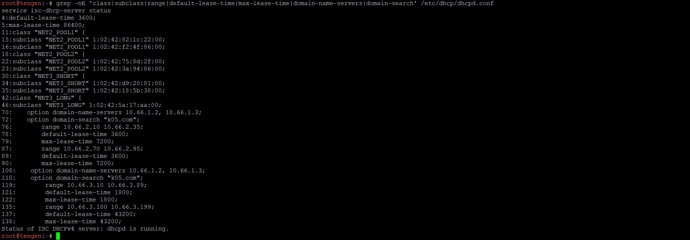

Perbedaan batas rentang dan masa sewa merupakan inti persyaratan No. 5.

### Foto 2: Ino: alamat short lease dan DNS

Tampilan IP `10.66.3.10/24`, gateway `10.66.3.1`, serta DNS/search domain.

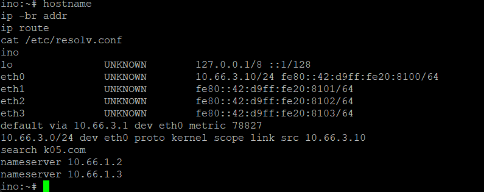

Alamat Ino termasuk pool short `.3.10–.3.89`.

### Foto 3: Kusakabe: alamat short lease dan DNS

Tampilan IP `10.66.3.11/24`, gateway `10.66.3.1`, serta DNS/search domain.

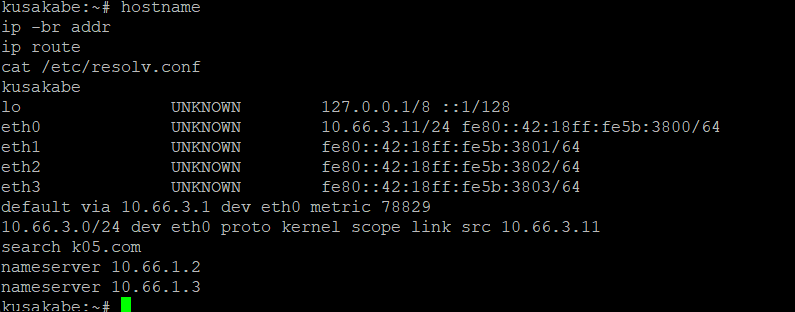

Kusakabe berada pada pool dan jaringan yang sama dengan Ino namun menggunakan alamat berbeda.

### Foto 4: Miwa: alamat long lease dan DNS

Tampilan IP `10.66.3.100/24` serta gateway dan resolusi DNS yang sesuai.

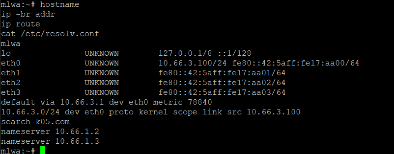

Miwa tergolong long lease; pada sebagian sesi nama jendela/terminal tampak sebagai `mlwa`, tetapi IP dan konfigurasi mengacu ke klien Miwa. Saat audit 15 Oktober, MAC Miwa yang aktif berbeda dari entri kelas lama. Saya menambahkan MAC `f2:dd:ec:51:c9:cb` ke `NET3_LONG` pada Tengen dan menyimpan konfigurasi terbaru untuk pemulihan boot. Miwa kemudian memperoleh `10.66.3.100/24`; berkas lease mencatat selisih `starts` dan `ends` tepat 43200 detik.

## Hasil

Pemisahan pool DHCP Network 3 menghasilkan IP yang tepat untuk klien short lease dan long lease, serta menyeragamkan gateway, DNS, dan search domain. Masa lease diverifikasi melalui kebijakan server dan dapat dikonfirmasi kembali melalui field lease saat renewal.

---

# 6. DHCP Static Lease untuk Kugisaki

## Soal

> Kugisaki ditetapkan sebagai personel VIP yang harus mempertahankan alamat yang sama setiap kali terhubung. Buat DHCP static lease berdasarkan MAC Address client tersebut dengan fixed address [PREFIX IP].3.99. Pastikan alamat ini berada di luar seluruh pool dinamis, validasi konfigurasi server, lalu renew lease pada client. Buktikan bahwa alamat yang diterima sesuai dengan reservasi.

Saya memasangkan MAC Kugisaki dengan `fixed-address 10.66.3.99`. DHCP reservation menjaga alamatnya tetap sama; `.99` dipilih di luar pool short dan long agar tidak dipinjamkan ke klien lain.

## Reservasi alamat Kugisaki

| Komponen | Nilai | Fungsi |
| --- | --- | --- |
| Host | `kugisaki` | Client yang menerima reservasi khusus. |
| MAC Address | `02:42:c0:e6:67:00` | Identitas client DHCP. |
| IP reservation | `10.66.3.99` | IP yang dipertahankan pada request berikutnya. |
| Gateway | `10.66.3.1` | Gateway Network 3. |
| Subnet mask | `/24` | Menjaga alamat tetap di `10.66.3.0/24`. |
| DNS | `10.66.1.2`, `10.66.1.3` | Opsi DNS yang sama dengan client lain. |

## Penjelasan Teknis

IP `10.66.3.99` terletak di luar pool short (`.10–.89`) dan long (`.100–.199`). Hal ini sengaja dilakukan agar server DHCP tidak memberikan alamat tersebut kepada client dinamis lain. Pemetaan berbasis MAC membuat Kugisaki memperoleh alamat yang telah ditentukan selama konfigurasi reservation dan identitas MAC tetap sama.

**Static lease** berbeda dari konfigurasi IP statis lokal: alamat tetap diberikan melalui protokol DHCP. Karena itu Kugisaki tetap menerima DHCP options seperti gateway, DNS, subnet mask, dan domain search dari server.

## Perintah yang saya jalankan

Perintah berlabel setup mengubah konfigurasi atau layanan; perintah berlabel cek hanya membaca status dan hasilnya. Skrip gabungan di repository adalah dokumentasi yang perlu dicocokkan dengan keadaan node sebelum dijalankan ulang.

Jalankan skrip per-node `sh /root/soal6-tengen.sh` pada Tengen.

**Node konfigurasi:** `tengen`. **Node uji:** `kugisaki`.

**Langkah 1: Jalankan skrip reservation di Tengen setelah memastikan Soal 4–5 selesai.**

```sh
sh /root/soal6-tengen.sh
```

Skrip menambahkan reservasi jika deklarasi host belum ada. MAC target adalah `02:42:c0:e6:67:00`, dengan fixed address `10.66.3.99`.

**Langkah 2: Verifikasi deklarasi host dan konfigurasi server.**

```bash
grep -A4 -B1 'host kugisaki' /etc/dhcp/dhcpd.conf
dhcpd -t -cf /etc/dhcp/dhcpd.conf
service isc-dhcp-server status
```

**Langkah 3: Pada Kugisaki, perbarui lease.**

```sh
udhcpc -i eth0 -q -n
ip -br addr show eth0
ip route
cat /etc/resolv.conf
```

**Ekspektasi:** `10.66.3.99/24`, gateway `10.66.3.1`, DNS Utahime/Shoko. IP Kugisaki tetap berada di luar rentang short lease dan long lease.

**Konfigurasi setelah setup:** Reservasi DHCP untuk MAC Kugisaki menunjuk `10.66.3.99`, di luar kedua pool dinamis.

## Hasil pengujian

Bukti sisi server memperlihatkan `hardware ethernet` dan `fixed-address`, sementara bukti sisi client menunjukkan Kugisaki mendapat `10.66.3.99/24` dengan default gateway `10.66.3.1`. Karena `.99` tidak berada pada pool dinamis, alamat VIP tidak diperebutkan oleh anggota pool lain.

## Bukti hasil

### Foto 1: Tengen: deklarasi reservation Kugisaki

Bukti bahwa MAC `02:42:c0:e6:67:00` diarahkan pada IP `10.66.3.99`.

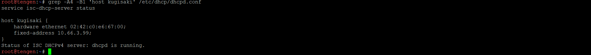

Fixed address dicocokkan dengan hardware Ethernet address untuk menghindari alokasi acak.

### Foto 2: Kugisaki: IP tetap, DNS, dan gateway

Hasil verifikasi IP DHCP `10.66.3.99/24`, default gateway, serta konfigurasi DNS.

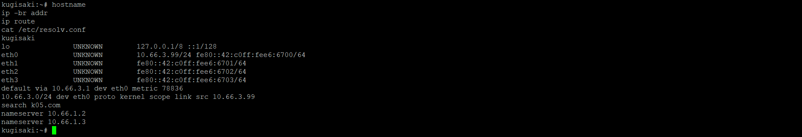

Lease yang diperoleh sesuai dengan reservasi, bukan rentang short maupun long lease.

## Hasil

Reservation khusus Kugisaki berhasil disiapkan di luar pool dinamis dan ditunjukkan melalui konsistensi konfigurasi server dengan alamat yang diterima client.

---

# 7. Audit IP Address, Gateway, DNS, dan DHCP Lease

## Soal

> Setelah aturan alokasi diterapkan, pastikan setiap client menerima konfigurasi jaringan sesuai wilayahnya: subnet mask 255.255.255.0 (/24), gateway dan broadcast address yang benar, DNS [PREFIX IP].1.2 serta [PREFIX IP].1.3, dan domain-search yang ditentukan. Periksa IP address dan routing seluruh client Divisi A dan Divisi B, kemudian cocokkan lease dengan /var/lib/dhcp/dhcpd.leases pada tengen. Pastikan tidak ada alamat yang bertabrakan atau berada di luar kebijakan pool.

Saya mencocokkan IP, gateway, DNS, dan lease di klien dengan catatan `dhcpd.leases` pada Tengen. Ini menguji hasil alokasi DHCP, bukan hanya isi file konfigurasi server.

## Audit alokasi DHCP

| Komponen audit | Nilai yang diperiksa | Risiko bila salah |
| --- | --- | --- |
| Alamat IP | Sesuai class, pool, atau reservation | Client mendapat alamat kelas lain atau terjadi konflik. |
| Prefix subnet | `/24` | Client menganggap host beda subnet sebagai lokal. |
| Default gateway | `.2.1` atau `.3.1` | Trafik keluar segmen gagal diteruskan. |
| Broadcast address | `.2.255` atau `.3.255` | Protokol broadcast tidak sesuai network. |
| DNS DHCP | `10.66.1.2`, `10.66.1.3` | Resolusi nama tidak mengikuti desain. |
| Search domain | `k05.com` | Nama host pendek tidak mendapatkan suffix internal. |
| File lease server | `/var/lib/dhcp/dhcpd.leases` | Perlu membuktikan alokasi tercatat dan menghindari konflik. |
| Tes ping | Gateway dan Tengen | Membedakan konfigurasi lokal dari konektivitas aktual. |

## Analisis Pemetaan dan Kriteria Audit

### Network 2

| Client | Jenis | IP yang terlihat | Gateway |
| --- | --- | --- | --- |
| Itadori | Pool 1 | `10.66.2.10/24` | `10.66.2.1` |
| Fushiguro | Pool 1 | `10.66.2.11/24` | `10.66.2.1` |
| Zenin | Pool 2 | `10.66.2.70/24` | `10.66.2.1` |
| Okkotsu | Pool 2 | `10.66.2.71/24` | `10.66.2.1` |

### Network 3

| Client | Jenis | IP yang terlihat | Gateway |
| --- | --- | --- | --- |
| Ino | Short lease | `10.66.3.10/24` | `10.66.3.1` |
| Kusakabe | Short lease | `10.66.3.11/24` | `10.66.3.1` |
| Miwa | Long lease | `10.66.3.100/24` | `10.66.3.1` |
| Kugisaki | Fixed address | `10.66.3.99/24` | `10.66.3.1` |

Untuk mencegah kesalahan validasi, alamat tetap pada tabel dibandingkan dengan *jenis kebijakan*. Berbeda dengan fixed address Kugisaki, IP client pool tetap bisa berubah pada pembaruan lease selama tidak keluar dari rentang yang diizinkan.

## Perintah yang saya jalankan

Skrip gabungan nomor ini hanya dipakai untuk pemeriksaan. Setup yang menghasilkan konfigurasi atau paket pada foto dijelaskan pada langkah praktikum, dan saya tidak mengklaim skrip rekonstruksi sebagai salinan perintah lama.

Di Tengen jalankan `sh /root/soal7-tengen.sh`. Pada setiap klien DHCP jalankan `sh /root/soal7-client-dhcp.sh`.

**Node uji:** seluruh client DHCP, terutama Itadori, Zenin, Ino, Miwa, dan Kugisaki. **Node server:** Tengen.

**Langkah 1: Audit di setiap client DHCP** (Itadori, Ino, Fushiguro, Kusakabe, Kugisaki, Miwa, Okkotsu, dan Zenin).

```sh
sh /root/soal7-client-dhcp.sh
```

**Langkah 2: Periksa detail bila ada nilai yang tidak cocok.**

```sh
sh /root/soal7-client-dhcp.sh
```

**Langkah 3: Di Tengen, periksa lease dan server.**

```sh
sh /root/soal7-tengen.sh
dhcpd -t -cf /etc/dhcp/dhcpd.conf
service isc-dhcp-server status
less /var/lib/dhcp/dhcpd.leases
```

**Ekspektasi:** semua client `/24`, gateway sesuai jaringan, DNS `10.66.1.2` dan `10.66.1.3`, search `k05.com`, serta alamat dalam pool/kelas masing-masing. Lease Kugisaki harus sesuai reservasi `10.66.3.99`.

**Catatan:** file lease menyimpan riwayat, sehingga beberapa entri lama tidak berarti ada bentrok aktif. Cari binding terakhir untuk IP yang diperiksa.

**Konfigurasi setelah setup:** Tidak ada perubahan konfigurasi. Alamat klien, gateway, DNS, dan file lease Tengen diperiksa bersama.

## Hasil pengujian

Bukti audit memperlihatkan indikator “HASIL: CLIENT SESUAI KEBIJAKAN” pada beberapa kelas, antara lain Pool 1 (Itadori), Pool 2 (Zenin), short lease (Ino), dan long lease (Miwa). Pada server, file lease dapat dibaca beserta catatan MAC dan status binding. Foto No. 4–6 melengkapi audit untuk anggota kelas lain dan Kugisaki. Kebijakan yang disyaratkan terbukti dari dua sudut: konfigurasi alamat pada client dan pencatatan alokasi oleh DHCP Server.

## Bukti hasil

### Foto 1: Itadori: audit client Pool 1

Tampilan pemeriksaan IP, subnet, gateway, DNS, dan konektivitas Itadori.

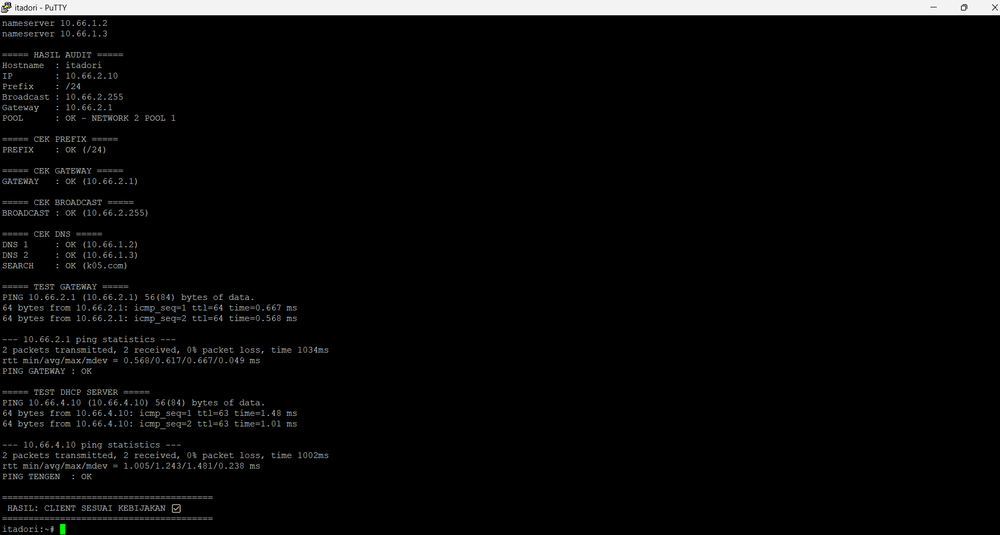

Status audit menunjukkan klien sesuai kebijakan Pool 1 dan dapat menjangkau tujuan tes.

### Foto 2: Zenin: audit client Pool 2

Memperlihatkan pemeriksaan IP Zenin, resolusi DNS DHCP, dan tes konektivitas.

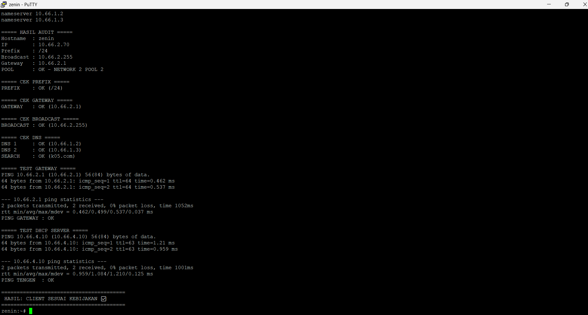

Zenin merupakan sampel kelas Pool 2; alamat yang terlihat tidak melanggar rentang pool.

### Foto 3: Ino: audit client short lease

Tampilan audit Ino yang berada dalam rentang short lease Network 3.

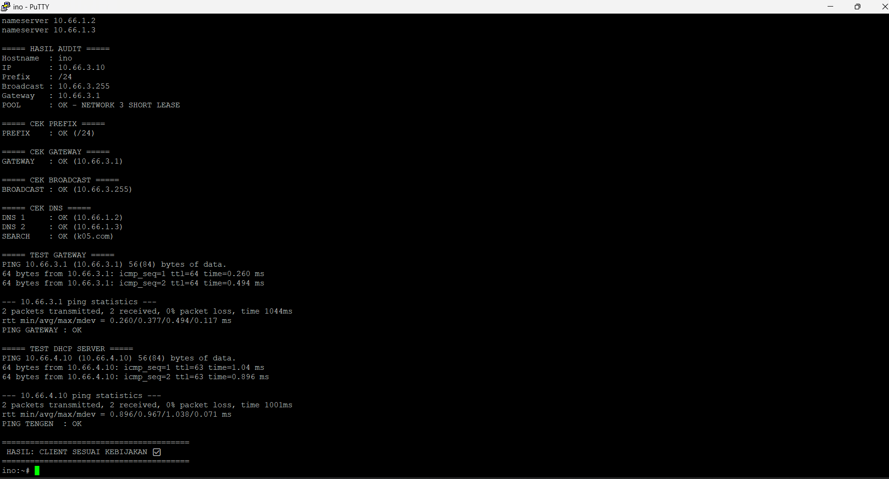

Pemeriksaan gateway, DNS, dan konektivitas membantu membuktikan konfigurasi bukan sekadar keberhasilan memperoleh IP.

### Foto 4: Miwa: audit client long lease

Memperlihatkan konfigurasi Miwa yang termasuk pool long lease.


IP Miwa sesuai rentang `.3.100–.3.199`, sedangkan bukti server menjadi referensi durasi lease.

### Foto 5: Tengen: catatan DHCP lease bagian pertama

Tampilan status DHCP Server dan awal isi `/var/lib/dhcp/dhcpd.leases`.

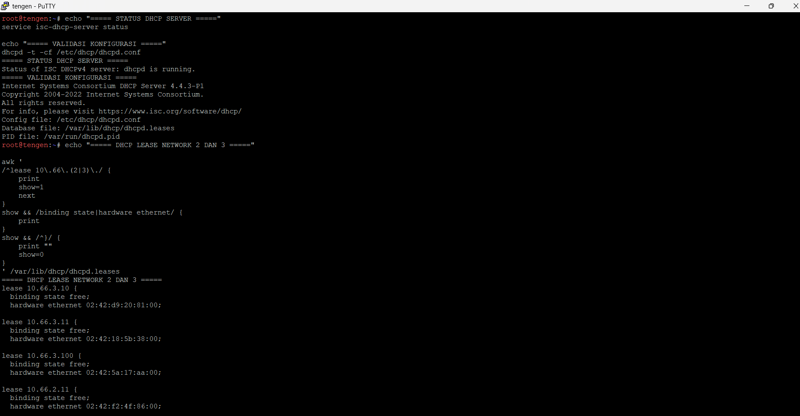

Catatan ini menunjukkan hubungan alokasi client dengan basis data lease yang dikelola DHCP Server.

### Foto 6: Tengen: catatan DHCP lease dan Kugisaki

Tampilan lanjutan file lease server, termasuk catatan terkait client dan reservation.

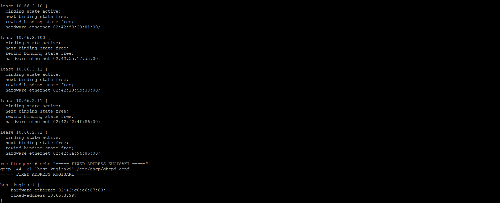

Pemeriksaan file lease melengkapi audit agar tidak hanya berdasarkan output sisi client.

## Hasil

Audit menunjukkan pengalamatan, gateway, DNS, search domain, dan konektivitas sejumlah client sesuai rancangan. Catatan lease di Tengen juga tersedia untuk membantu mengevaluasi pembagian alamat dan potensi konflik. Bukti IP client lainnya turut tersedia pada No. 4–6.

---

# 8. Packet Capture dan Analisis Proses DHCP DORA

## Soal

> Sebelum Curtain dibuka kembali, buktikan bahwa proses pemberian alamat berjalan sesuai protokol. Lakukan packet capture saat salah satu client Network 2 atau Network 3 meminta lease baru. Gunakan tcpdump pada tengen atau jalur menuju Data Center untuk menunjukkan urutan DHCPDISCOVER → DHCPOFFER → DHCPREQUEST → DHCPACK. Identifikasi alamat server, alamat yang diberikan, lease time, dan field giaddr. Pastikan nilai giaddr sesuai dengan interface jichi yang menerima request dari subnet client.

Saya menangkap paket DHCP saat klien meminta lease. Urutan Discover, Offer, Request, ACK disebut DORA; `giaddr` pada paket menunjukkan antarmuka Jichi tempat permintaan klien masuk.

## Pembacaan paket DHCP

Pengujian IP pada client hanya membuktikan konfigurasi **akhir**. Soal ini meminta pembuktian **proses**. Dengan `tcpdump`, paket DHCP di jalur server direkam sehingga seluruh langkah pemberian lease dapat ditelusuri, termasuk identitas server, alamat yang diberikan, durasi, dan nilai `giaddr`.

| Tahap | Arah umum | Kegunaan |
| --- | --- | --- |
| **DHCPDISCOVER** | Client → Relay → Server | Client mencari server DHCP. |
| **DHCPOFFER** | Server → Relay → Client | Server menawarkan alamat dan konfigurasi. |
| **DHCPREQUEST** | Client → Relay → Server | Client meminta tawaran yang dipilih. |
| **DHCPACK** | Server → Relay → Client | Server mengonfirmasi pemberian lease. |

## Analisis Parameter DHCP

Pengujian menggunakan Itadori sebagai client Network 2. Field yang diharapkan dan teramati:

| Parameter | Nilai | Interpretasi |
| --- | --- | --- |
| Server DHCP | `10.66.4.10` | Tengen di Network 4. |
| Alamat client | `10.66.2.10` | IP di Pool 1 Network 2. |
| Lease time | `3600` detik | Jangka waktu lease pada pengujian DORA Itadori. |
| `giaddr` | `10.66.2.1` | Interface relay Jichi tempat request berasal. |
| Prefix client | `/24` | Client berada pada `10.66.2.0/24`. |
| Gateway client | `10.66.2.1` | Jalur keluar Network 2. |

Field `giaddr` **bukan** alamat Tengen dan bukan pula IP client. Nilai tersebut diisi oleh relay untuk menunjukkan segmen asal sehingga server dapat memilih konfigurasi scope yang benar. Karena paket berasal dari Network 2, `giaddr` bernilai `10.66.2.1`.

## Perintah yang saya jalankan

Skrip gabungan nomor ini dipakai untuk uji capture dan renew lease. Pengujian ini dapat memicu permintaan DHCP baru; saya tidak mengklaim skrip rekonstruksi sebagai salinan perintah lama.

Gunakan `sh /root/soal8-tengen.sh` pada Tengen untuk capture dan pembacaan hasil, lalu `sh /root/soal8-itadori.sh` pada Itadori untuk memicu permintaan DHCP.

**Node capture:** `tengen`. **Node pemicu DHCP:** `itadori`.

**Langkah 1: Siapkan capture pada Tengen.** Jalankan command berikut di terminal Tengen; biarkan berjalan saat pindah ke terminal Itadori.

```sh
sh /root/soal8-tengen.sh
```

File capture disimpan sebagai `/root/soal8-dhcp.pcap` oleh skrip. Capture berhenti setelah batas waktu skrip.

**Langkah 2: Saat capture aktif, pada Itadori minta lease baru.**

```sh
sh /root/soal8-itadori.sh
```

Jika tidak muncul proses DORA lengkap karena lease lama masih aktif, lakukan pengujian ulang pada sesi lab dengan menghentikan client DHCP lama terlebih dahulu, lalu renew dengan skrip eksperimen yang memang digunakan pada node tersebut. Hindari flush IP pada koneksi yang sedang dipakai untuk administrasi jarak jauh.

**Langkah 3: Setelah capture selesai, baca hasil di Tengen.**

```bash
sh /root/soal8-tengen.sh
tcpdump -nn -vvv -r /root/soal8-dhcp.pcap 2>/dev/null | grep -E 'Gateway-IP|Your-IP|Server-ID|Lease-Time'
```

**Ekspektasi:** empat tahap `Discover → Offer → Request → ACK`, server `10.66.4.10`, leased IP `10.66.2.10`, gateway relay (`giaddr`) `10.66.2.1`, dan lease `3600` detik. Jika paket kurang lengkap, ulangi capture **sebelum** menjalankan DHCP client.

**Konfigurasi setelah setup:** Tidak ada perubahan konfigurasi. Berkas capture memuat paket DORA untuk dibaca kembali.

## Hasil pengujian

Capture berhasil memperlihatkan keempat jenis pesan DHCP secara lengkap dan berurutan. Paket menunjukkan server `10.66.4.10`, alamat yang diberikan `10.66.2.10`, lease `3600` detik, serta `giaddr = 10.66.2.1`. Sementara itu, Itadori memperoleh alamat Pool 1 yang sama dan gateway `10.66.2.1`. Kecocokan sisi server, relay, dan client menjadi bukti end-to-end pemberian lease.

## Bukti hasil

### Foto 1: Tengen: urutan DHCP Discover, Offer, Request, ACK

Output `tcpdump` yang menampilkan keempat pesan inti proses DORA.

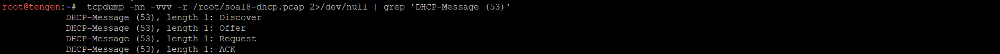

Empat tahap membuktikan proses lease berjalan hingga dikonfirmasi, bukan berhenti di paket penawaran.

### Foto 2: Tengen: Server-ID, alamat lease, dan giaddr

Memperlihatkan field DHCP yang digunakan untuk mengidentifikasi server, IP client, durasi, dan interface relay.

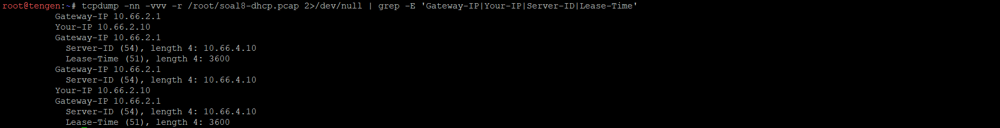

`giaddr = 10.66.2.1` sesuai sisi Network 2 Jichi yang menerima broadcast dari Itadori.

### Foto 3: Itadori: renew lease dan pengalamatan hasil

Menunjukkan request DHCP dari Itadori dan kondisi alamat/gateway setelah memperoleh lease.

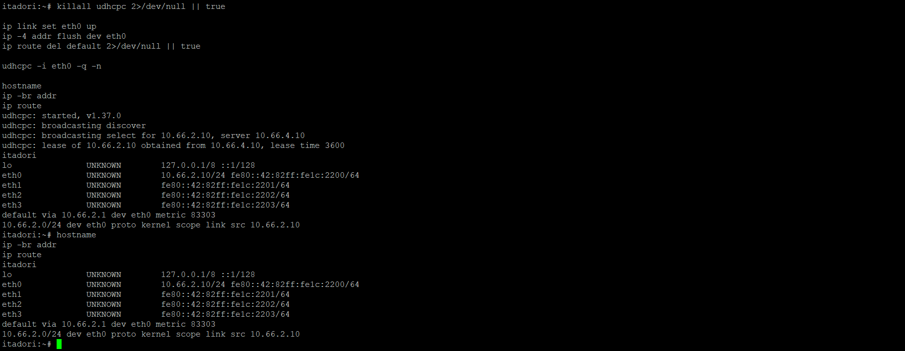

Alamat `10.66.2.10/24` cocok dengan penawaran yang tercatat di capture.

## Hasil

Proses DHCP berlangsung lengkap melalui urutan DORA, dan field teknis pada paket sesuai rute Network 2 melalui Jichi ke Tengen. Relay tidak hanya memberi hasil IP yang benar, tetapi juga bekerja sesuai mekanisme protokol DHCP.

---

# 9. Simulasi Gangguan serta Pemulihan DHCP Relay

## Soal

> Sebuah gangguan memutus jalur relay dan membuat permintaan alamat tidak sampai ke Data Center. Hentikan service DHCP Relay pada jichi, lalu paksa salah satu client di Network 2 atau Network 3 meminta lease baru dan catat gejalanya. Pulihkan service relay, ulangi permintaan DHCP, lalu buktikan bahwa client kembali memperoleh alamat dari pool yang benar dengan gateway semula.

Saya menghentikan Relay sebentar untuk melihat gejala saat broadcast klien tidak sampai ke Tengen, lalu menghidupkannya kembali dan meminta lease baru. Ini menguji pemulihan jalur DHCP lintas subnet.

## Uji gangguan DHCP Relay

Soal tidak hanya menguji keberhasilan DHCP saat kondisi normal, tetapi juga memastikan kegagalan ketika satu komponen penting berhenti dan keberhasilan setelah dipulihkan. Relay adalah titik penghubung broadcast client ke server remote. Ketika relay berhenti, client Network 2/3 yang meminta lease baru tidak dapat memperoleh tawaran DHCP dari Tengen meskipun server masih aktif di Network 4.

| Kondisi | Relay Jichi | Request Itadori | Hasil yang diharapkan |
| --- | --- | --- | --- |
| Sebelum gangguan | RUNNING | Diteruskan ke Tengen | Lease berhasil. |
| Simulasi gangguan | STOPPED | Tidak diteruskan | Request baru gagal / timeout. |
| Setelah pemulihan | RUNNING | Diteruskan lagi | Lease Pool 1 berhasil, gateway sama. |

## Perintah yang saya jalankan

Perintah berlabel setup mengubah konfigurasi atau layanan; perintah berlabel cek hanya membaca status dan hasilnya. Skrip gabungan di repository adalah dokumentasi yang perlu dicocokkan dengan keadaan node sebelum dijalankan ulang.

Gunakan `sh /root/soal9-jichi.sh` pada Jichi dan `sh /root/soal9-itadori.sh` pada Itadori, dengan argumen aksi sesuai langkah di bawah.

**Tujuan pengujian:** membuktikan komunikasi DHCP dari Itadori bergantung pada relay Jichi. **Peringatan:** tahap pertama memang sengaja memutus fungsi DHCP; lakukan hanya pada lab GNS3 dan pastikan bisa kembali ke terminal Jichi.

**Langkah 1: Hentikan relay dari Jichi.**

```bash
sh /root/soal9-jichi.sh stop
sh /root/soal9-jichi.sh status
```

**Ekspektasi:** status relay `STOPPED`/proses `dhcrelay` tidak ditemukan.

**Langkah 2: Uji kegagalan di Itadori.**

```sh
sh /root/soal9-itadori.sh fail
```

**Ekspektasi:** permintaan `DHCPDISCOVER` berulang dan gagal mendapatkan lease; tidak ada alamat IPv4 dinamis yang baru diperoleh.

**Langkah 3: Pulihkan relay di Jichi.**

```bash
sh /root/soal9-jichi.sh start
sh /root/soal9-jichi.sh status
```

**Ekspektasi:** relay `RUNNING`, mengarah ke `10.66.4.10` via `eth2`, `eth3`, dan `eth4`.

Pada audit 15 Oktober, saya menemukan `/etc/default/isc-dhcp-relay` kosong setelah node hidup kembali. Karena itu `service isc-dhcp-relay start` saja tidak memulihkan relay. Saya menghentikan relay di Jichi, memastikan permintaan baru Okkotsu gagal, lalu menjalankan skrip pemulihan DHCP Relay yang dipasang oleh Soal 10. Skrip tersebut menjalankan `dhcrelay` langsung dengan tiga interface dan alamat Tengen yang benar. Sesudahnya Okkotsu kembali mendapat `10.66.2.71/24`; foto di bawah tetap mencatat sesi pengujian awal.

**Langkah 4: Minta ulang lease di Itadori.**

```sh
sh /root/soal9-itadori.sh recover
ip -br addr show eth0
ip route
```

**Ekspektasi:** Itadori kembali mendapat `10.66.2.10/24` dengan gateway `10.66.2.1`.

> Jangan berhenti setelah tahap gagal: relay **wajib diaktifkan kembali** agar pengujian berikutnya tidak terganggu.

**Konfigurasi setelah setup:** Setelah simulasi, DHCP Relay Jichi kembali berjalan dan klien memperoleh lease lagi.

## Hasil pengujian

Foto menunjukkan status `STOPPED`, kemudian Itadori gagal memperoleh alamat setelah beberapa pengiriman `DHCPDISCOVER` dan menampilkan pesan kegagalan lease. Setelah Jichi mengaktifkan kembali relay, proses `dhcrelay` berjalan dan Itadori memperoleh `10.66.2.10/24` dengan default gateway `10.66.2.1`. Bukti ini memperlihatkan ketergantungan layanan DHCP pada relay serta keberhasilan prosedur pemulihannya.

## Bukti hasil

### Foto 1: Jichi: DHCP Relay dihentikan

Bukti penghentian layanan dengan status relay `STOPPED`.

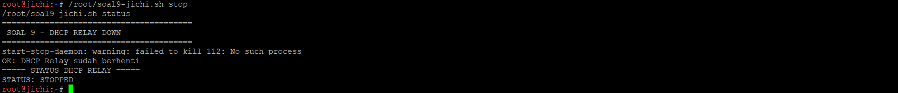

Tidak ditemukannya proses relay aktif merupakan dasar bahwa pengujian gangguan memang berlangsung pada komponen yang relevan.

### Foto 2: Itadori: DHCP gagal ketika relay mati

Menampilkan beberapa `DHCPDISCOVER`, kegagalan memperoleh lease, dan pemeriksaan IP setelah pengujian.

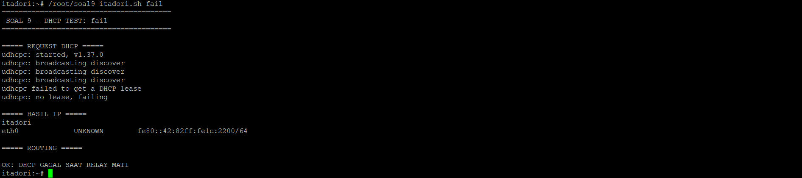

Kegagalan saat relay dimatikan mendukung bahwa request broadcast tidak dapat mencapai Tengen secara langsung.

### Foto 3: Jichi: relay dipulihkan dan berjalan

Menunjukkan status `RUNNING` serta proses `dhcrelay` yang meneruskan ke `10.66.4.10`.

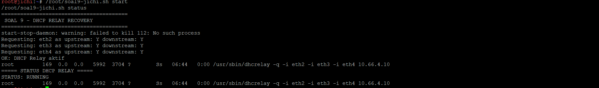

Layanan kembali siap menerima request Network 2 dan Network 3.

### Foto 4: Itadori: DHCP kembali berhasil

Menampilkan penerimaan lease `10.66.2.10` dan kembalinya rute default `10.66.2.1`.

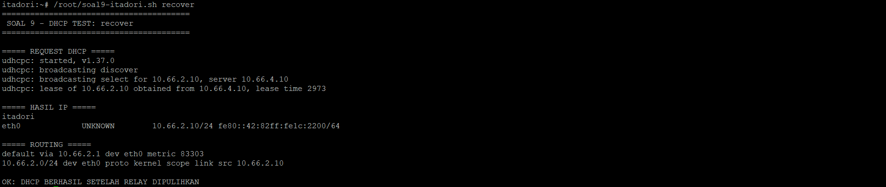

Pemulihan berhasil tanpa mengubah kebijakan pool dan gateway semula.

## Hasil

Simulasi gangguan membuktikan bahwa DHCP Relay diperlukan untuk pengalokasian alamat client lintas-subnet. Ketika relay dihentikan, request baru gagal; setelah relay dipulihkan, IP Pool 1 dan gateway semula kembali diterima dengan benar.

---

# 10. Autostart DHCP Server dan DHCP Relay Setelah Restart

## Soal

> Setelah gangguan Shibuya tertangani, pastikan pemulihan bertahan setelah restart. Aktifkan autostart DHCP Server pada tengen dan DHCP Relay pada jichi, lalu restart kedua node. Verifikasi status layanan, IP, gateway, lease, dan konektivitas client Network 2–3. Pastikan kebijakan Pool 1, Pool 2, short lease, long lease, dan fixed address tetap berlaku.

Saya memasang hook startup pada Jichi dan Tengen lalu menguji setelah restart. Daemon yang berhasil dijalankan manual belum membuktikan layanan tetap tersedia ketika node GNS3 dinyalakan ulang.

## Autostart layanan DHCP

Perbaikan layanan saat node masih hidup belum cukup memenuhi ketentuan praktikum. Dalam lingkungan GNS3 berbasis Docker, proses daemon yang dimulai secara manual dapat berhenti setelah node dimatikan atau restart. Karena itu DHCP Server dan DHCP Relay perlu ditautkan ke mekanisme startup node dan diverifikasi ulang setelah **Stop/Start node GNS3**, tanpa menyalakan service secara manual sesudah boot.

| Komponen | Lokasi | Fungsi |
| --- | --- | --- |
| DHCP Relay | `jichi` | Meneruskan DHCP dari Network 2/3 menuju Tengen. |
| DHCP Server | `tengen` | Menjaga ketersediaan daemon `dhcpd`. |
| Startup hook | `/root/init.sh` | Menjalankan skrip startup otomatis ketika container dimulai, bila dipanggil image. |
| Log startup Jichi | `/root/soal10-jichi-startup.log` | Bukti aktivitas pemulihan relay saat node boot. |
| Log startup Tengen | `/root/soal10-tengen-startup.log` | Bukti aktivitas pemulihan server saat node boot. |
| File lease | `/var/lib/dhcp/dhcpd.leases` | Menyimpan catatan lease agar state DHCP tetap dapat ditelusuri. |

## Analisis Mekanisme Startup

Image DebiNet pada GNS3 memakai proses inisialisasi berbasis `/etc/debinet-init.sh`; hook lokal `/root/init.sh` dapat dimanfaatkan untuk memanggil konfigurasi startup jika executable dan benar-benar di-load image tersebut. Pada node Jichi, startup menunggu tersedianya IP pada `eth4` (`10.66.4.1/24`), mengaktifkan forwarding IPv4, dan memastikan `dhcrelay` berjalan. Pada Tengen, versi pemulihan terbaru memastikan `eth0` memakai `10.66.4.10/24`, memasang ulang paket DHCP dan konfigurasi dari `/root` bila hilang, memvalidasi dengan `/usr/sbin/dhcpd -t`, lalu menyalakan satu proses `dhcpd`.

Pemeriksaan menunggu IP ini diperlukan untuk menghindari *race condition*: service dijalankan ketika interface belum siap atau route belum tersedia. Pemeriksaan menggunakan `pgrep` membantu mencegah duplikasi daemon ketika hook terpanggil lebih dari sekali.

## Perintah yang saya jalankan

Perintah berlabel setup mengubah konfigurasi atau layanan; perintah berlabel cek hanya membaca status dan hasilnya. Skrip gabungan di repository adalah dokumentasi yang perlu dicocokkan dengan keadaan node sebelum dijalankan ulang.

Jalankan `sh /root/soal10-jichi.sh` pada Jichi dan `sh /root/soal10-tengen.sh` pada Tengen.

**Node:** Jichi dan Tengen; kemudian ulangi audit pada beberapa client.

**Langkah 1: Pasang startup DHCP Relay pada Jichi.**

```sh
sh /root/soal10-jichi.sh
```

Skrip menyiapkan hook startup untuk mengaktifkan relay dan mencatat hasil ke `/root/soal10-jichi-startup.log`.

**Langkah 2: Pasang startup DHCP Server pada Tengen.**

```sh
sh /root/soal10-tengen.sh
```

Skrip final nomor 10 sekarang menyimpan salinan `dhcpd.conf` dan paket DHCP di `/root`, lalu menyiapkan startup layanan beserta log `/root/soal10-tengen-startup.log`. File `/root/soal10-dhcpd.conf` harus dibuat **setelah** aturan Pool 1, Pool 2, short lease, long lease, dan reservasi Kugisaki sudah final. Saat perbaikan 15 Oktober, saya memasang versi helper ini langsung di Tengen setelah membangun ulang konfigurasi soal 2–6. Jichi juga memakai helper yang menyimpan paket relay dan memanggil `/usr/sbin/dhcrelay` langsung; salinannya ada di [folder recovery](scrip-final/recovery/README.md).

**Langkah 3: Uji setelah Stop/Start node pada GNS3.** Berhentikan dan jalankan kembali node Jichi dan Tengen melalui GUI GNS3. Jangan hanya menjalankan ulang skrip secara manual untuk mengklaim autostart berhasil.

**Langkah 4: Setelah node hidup kembali, validasi otomatis di Jichi.**

```bash
pgrep -a dhcrelay
cat /proc/sys/net/ipv4/ip_forward
tail -20 /root/soal10-jichi-startup.log
```

**Ekspektasi:** `dhcrelay` aktif, forwarding `1`, log mencatat startup berhasil.

**Langkah 5: Validasi otomatis di Tengen.**

```bash
service isc-dhcp-server status
pgrep -a dhcpd
/usr/sbin/dhcpd -t -cf /etc/dhcp/dhcpd.conf
tail -20 /root/soal10-tengen-startup.log
```

**Ekspektasi:** `dhcpd is running` dan konfigurasi masih valid.

**Langkah 6: Audit ulang client sesudah restart.** Jalankan pada Itadori, Ino, dan Kugisaki:

```sh
udhcpc -i eth0 -q -n
sh /root/soal7-client-dhcp.sh
```

**Ekspektasi:** Itadori dari Pool 1 (`10.66.2.10`), Ino dari short lease (`10.66.3.10`), dan Kugisaki tetap fixed address (`10.66.3.99`). Alamat yang benar harus berasal dari layanan yang hidup otomatis sesudah node dinyalakan.

**Konfigurasi setelah setup:** Hook `/root/init.sh` pada Jichi dan Tengen memanggil skrip startup masing-masing. Pemeriksaan foto berikut berasal dari uji restart saat pengerjaan Soal 10. Pada 15 Oktober, saya juga melakukan Stop All lalu Start All penuh; DHCP, relay, dan kedelapan lease klien pulih otomatis tanpa helper manual. Audit seluruh soal setelah itu terhenti ketika pengendali GNS3 menampilkan `502 Bad Gateway`; detailnya ada di [audit](AUDIT-2026-10-15.md).

## Hasil pengujian

Dari foto yang tersedia, Jichi kembali menampilkan relay `RUNNING` dan IP forwarding `1` setelah node dijalankan. Tengen menunjukkan proses DHCP Server aktif beserta hasil pemeriksaan syntax. Client Itadori kembali sesuai Pool 1, Ino sesuai kelompok short lease, dan Kugisaki tetap menggunakan fixed address `10.66.3.99`. Bukti tersebut menguatkan bahwa kombinasi service dan kebijakan DHCP tetap berlaku setelah pemulihan node.

Namun, foto pengujian ulang **tidak mencakup seluruh delapan client** secara bersamaan: sampel setelah restart yang secara khusus didokumentasikan adalah Itadori, Ino, dan Kugisaki. Pemeriksaan Pool 2 dan Miwa telah tersedia di Soal 4–7 sebelum restart. Untuk pembuktian menyeluruh jika diminta asisten, audit kembali Fushiguro, Zenin, Okkotsu, Kusakabe, dan Miwa setelah restart dan tambahkan foto barunya.

## Bukti hasil

### Foto 1: Jichi: DHCP Relay autostart setelah restart

Bukti pemeriksaan log startup Jichi, forwarding, dan proses relay yang hidup setelah node dimulai ulang.

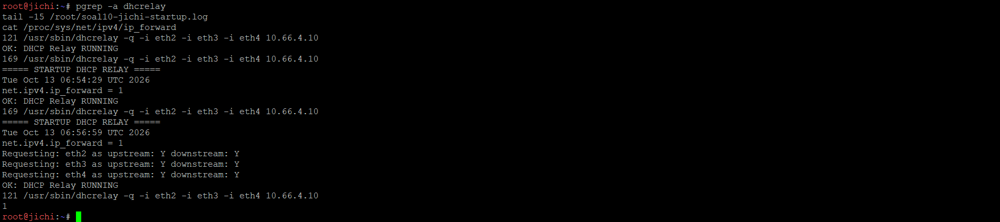

Keberadaan daemon pascarestart membedakan autostart dari prosedur pemulihan manual pada Soal 9.

### Foto 2: Tengen: DHCP Server autostart setelah restart

Bukti status `dhcpd` dan validasi konfigurasi setelah restart Tengen.

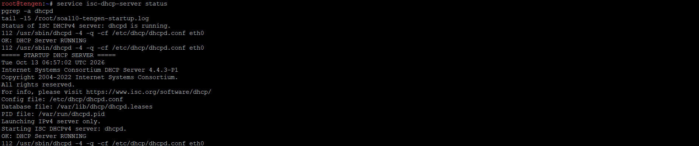

Layanan server perlu menyala secara mandiri sebelum client dapat menerima IP melalui Jichi.

### Foto 3: Itadori: Pool 1 masih sesuai setelah restart

Bukti audit IP/gateway/DNS Itadori setelah node infrastruktur direstart.


Alokasi Network 2 tetap tersedia dan sesuai Pool 1.

### Foto 4: Ino: kelompok short lease masih sesuai

Bukti audit Ino setelah restart yang memperlihatkan konfigurasi short lease.

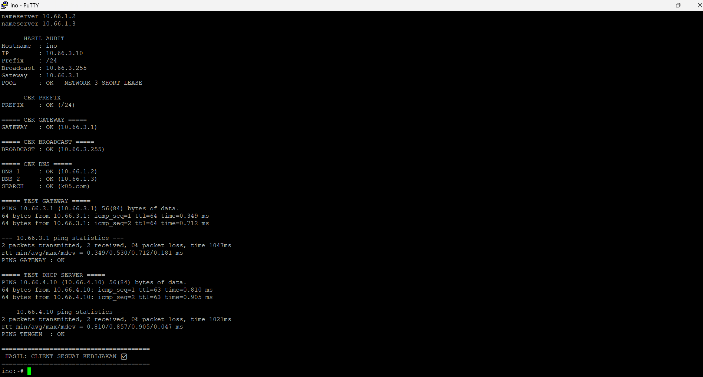

Pengelompokan Network 3 tidak hilang hanya karena daemon dihidupkan kembali.

### Foto 5: Kugisaki: fixed address tetap berlaku

Bukti audit ulang Kugisaki pada `10.66.3.99/24`.

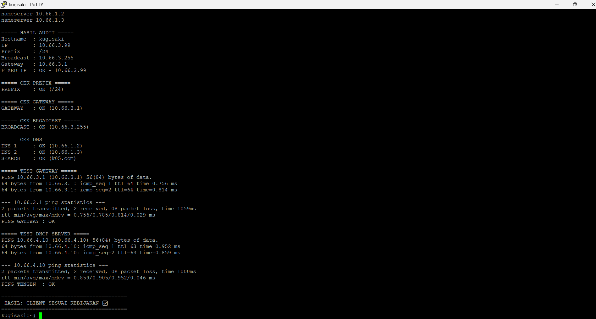

Reservation untuk MAC khusus tetap diterapkan sesudah proses restart.

## Hasil

Bukti layanan dan sebagian audit client setelah restart mendukung bahwa DHCP Relay di Jichi serta DHCP Server di Tengen berhasil dijalankan kembali secara otomatis dan kebijakan inti DHCP tidak berubah. Pengujian tambahan pada seluruh client tetap dapat dilengkapi untuk bukti autostart yang lebih komprehensif.

---

## Hasil tahap routing dan DHCP

Sampai soal 10, routing, NAT, dan DHCP telah diuji. Pengujian DNS hingga benchmark berlanjut pada soal 11–20 di bawah ini. Semua skrip gabungan tersedia di folder [`scrip-final/`](scrip-final/); nama file awalnya tetap tercatat pada langkah dan foto terkait.

---

# 11. DNS Master dan Slave

## Soal

> Utahime dan Shoko ditugaskan membangun sistem penamaan domain resmi agar seluruh pos tidak perlu menghafal alamat IP mentah. Konfigurasikan BIND9 pada utahime sebagai DNS Master dan shoko sebagai DNS Slave untuk mengelola domain jujutsu.\<xxxx>.com. Atur SOA record, NS delegasi untuk kedua server, dan terapkan allow-transfer dari Master ke Slave. Pastikan file zona berhasil tersinkronisasi otomatis ke shoko saat nomor serial di utahime dinaikkan, lalu buktikan dengan melakukan query dig ke kedua server dari salah satu client.

Saya menjadikan Utahime sumber zona `jujutsu.k05.com` dan Shoko penyimpan salinannya. Pada materi DNS Master–Slave, serial SOA adalah versi zona; Slave mengambil perubahan ketika serial Master naik.

## Maksud soal

Utahime menjadi sumber zona `jujutsu.k05.com`, sedangkan Shoko menyimpan salinannya. Ini mengikuti materi DNS Master–Slave pada Modul 2: SOA memuat serial zona, dua NS menunjuk kedua server, dan `allow-transfer` di Master hanya mengizinkan Shoko (`10.66.1.3`). Ketika serial naik, BIND memberi notifikasi agar Slave mengambil versi baru. Satu file konsolidasi untuk langkah ini ada di [`scrip-final/soal-11.sh`](scrip-final/soal-11.sh); bagian Utahime, Shoko, dan Itadori dipilih menurut hostname.

1. **Utahime**, dari console node (direktori kerja bebas), jalankan konfigurasi Master dengan nama skrip yang terlihat di node. Zona dan deklarasi Master harus lolos `named-checkzone` serta `named-checkconf`.

   **Setup.** Perintah pada console node:

   ```sh
   # Utahime
   sh /root/soal11-master.sh setup
   ```

   **Hasil yang saya periksa:** Zona Master lulus named-checkzone; `allow-transfer` hanya ke Shoko.

   Sebelum menulis zona, Utahime diperiksa alamat serta paket BIND-nya.

   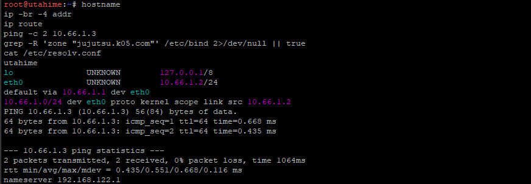

   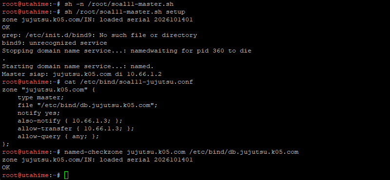

   Skrip Master dan hasil pemeriksaan zona memperlihatkan konfigurasi yang benar-benar dipakai.

   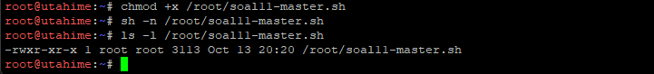

   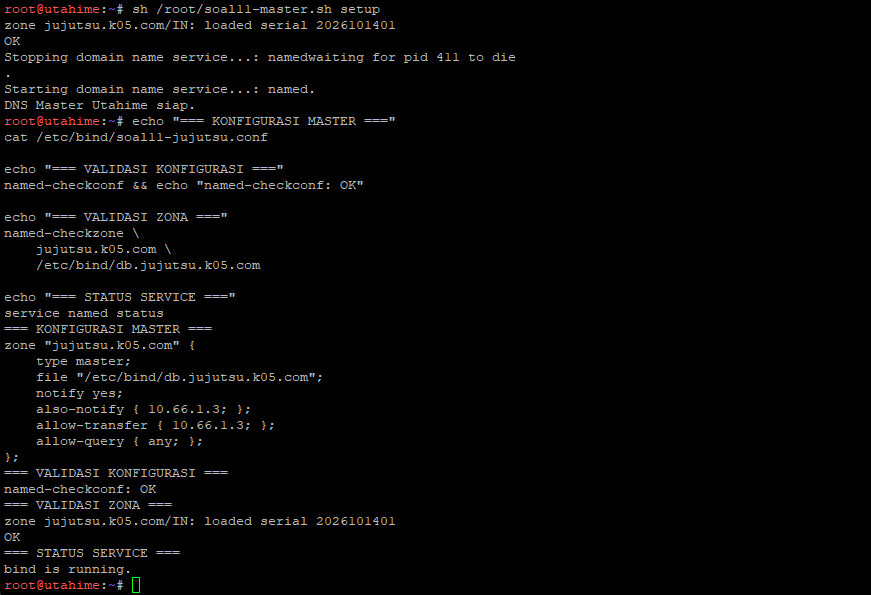

   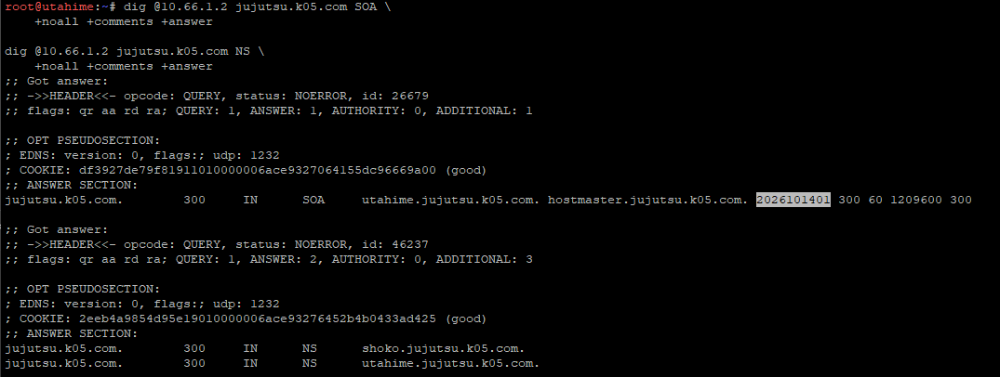

2. **Shoko**, jalankan skrip Slave dengan nama yang terlihat di node. Periksa file hasil transfer di `/var/cache/bind/db.jujutsu.k05.com`. Lokasi `/var/cache/bind` memang dipakai BIND untuk zona Slave yang diterima dari Master.

   **Setup.** Perintah pada console node:

   ```sh
   # Shoko
   sh /root/soal11-slave.sh setup
   ```

   **Hasil yang saya periksa:** Zona Slave ditransfer ke `/var/cache/bind` dari Utahime.

   Shoko diperiksa lebih dahulu, lalu BIND9 dipasang dan zona Slave dideklarasikan.

   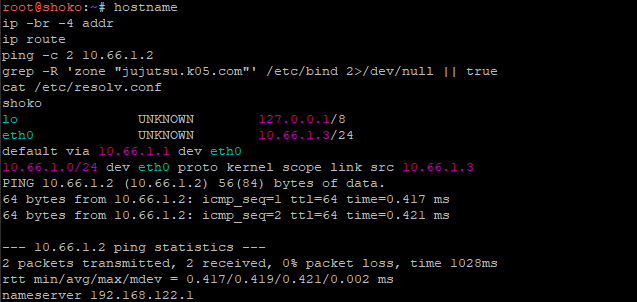

   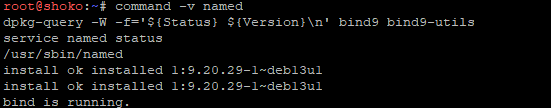

   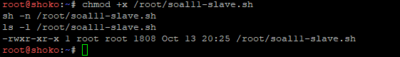

   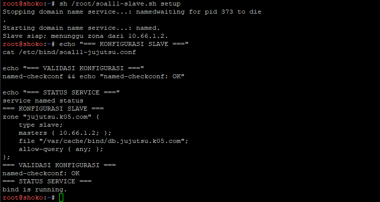

   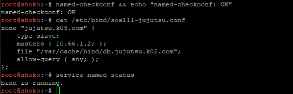

   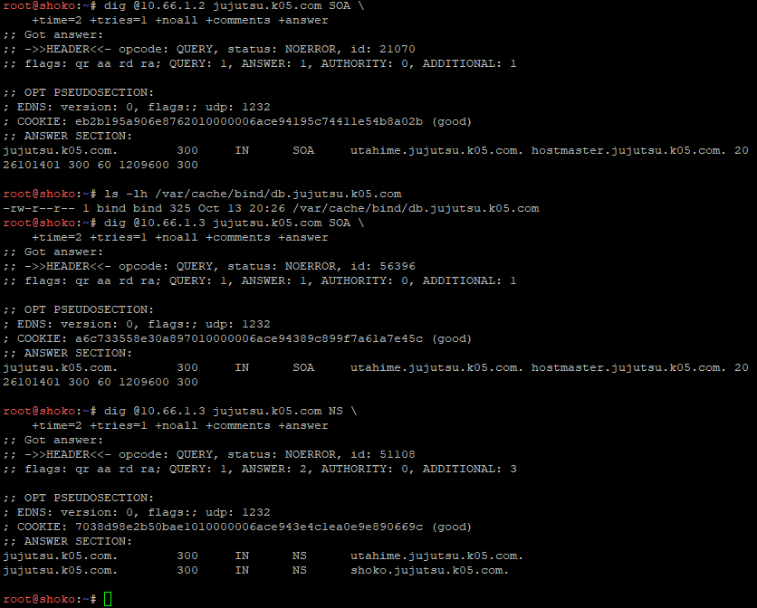

3. **Itadori**, jalankan `sh /root/soal11-test.sh` untuk mengecek SOA, NS, dan A dari kedua DNS. Kedua server harus menjawab `NOERROR` dan mengembalikan nama server serta alamat yang sama.

   **Cek.** Perintah pada console node:

   ```sh
   # Itadori
   sh /root/soal11-test.sh
   ```

   **Hasil yang saya periksa:** Kedua DNS menjawab SOA dan NS tanpa error.

   Perintah pengujian Itadori juga dicatat pada foto berikut.

   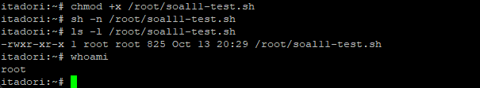

   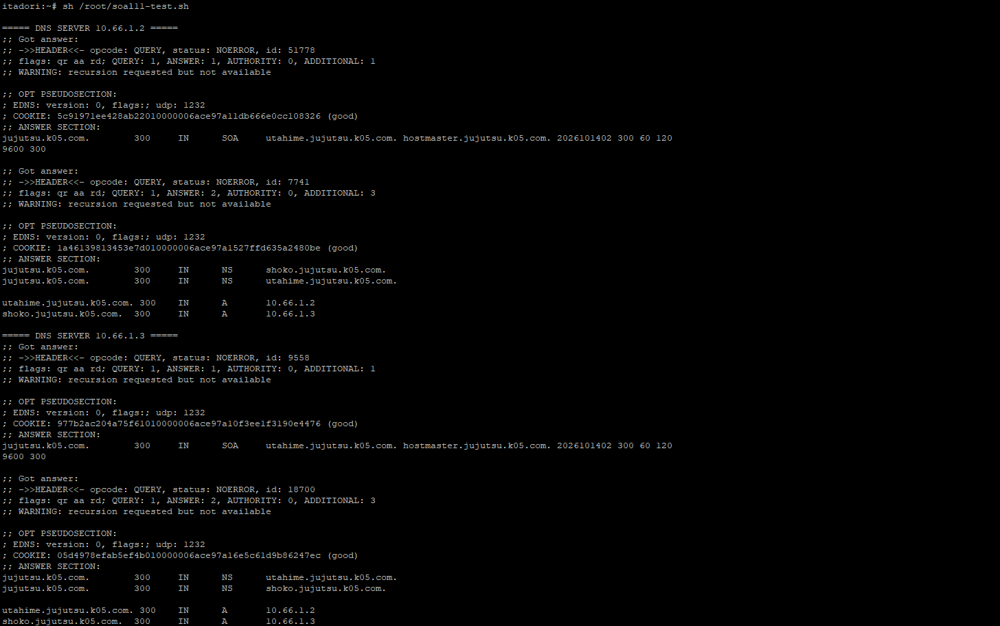

4. **Utahime**, naikkan serial dengan skrip Master yang terlihat di node, lalu ulangi query dari Itadori. Foto memperlihatkan serial `2026101401` menjadi `2026101402`; pada audit berikutnya serial sudah mencapai `2026101405`. Yang dinilai adalah serial Master dan Slave akhirnya **sama**, bukan angka serial tertentu.

   **Setup dan cek.** Perintah pada console node:

   ```sh
   # Utahime
   sh /root/soal11-master.sh bump
   # Itadori
   sh /root/soal11-test.sh
   ```

   **Hasil yang saya periksa:** Serial pada Master dan Slave akhirnya sama; angka serial akan naik dari percobaan sebelumnya.

   Sebelum serial dinaikkan, Itadori meminta SOA ke Master dan Slave.

   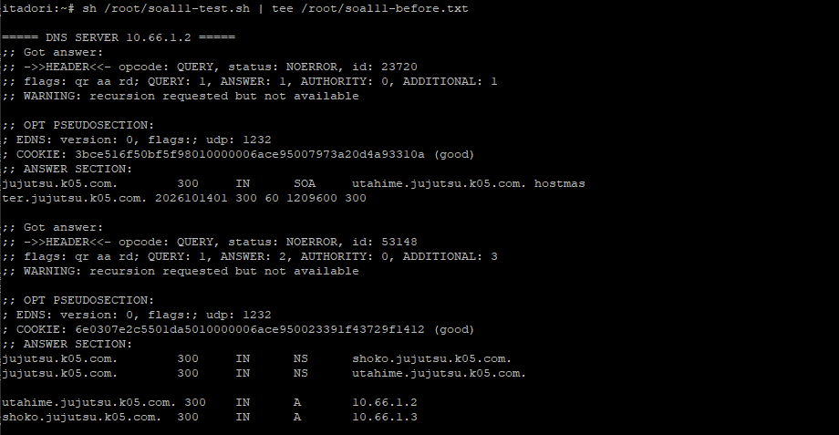

   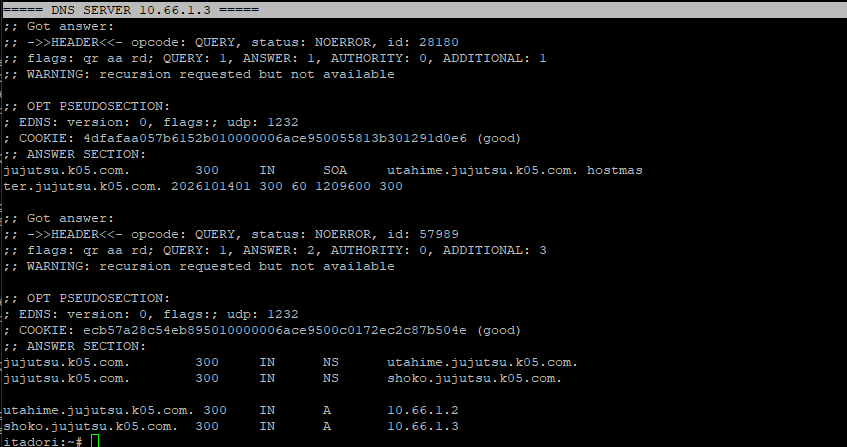

   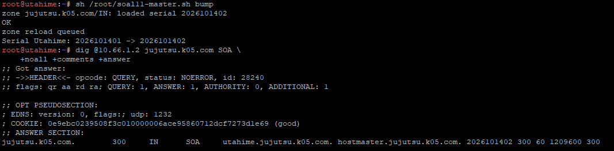

   Query berikutnya memperlihatkan serial yang sudah diambil Shoko.

   

   

   Pada audit ulang 15 Oktober, saya menaikkan serial sekali lagi dari `2026101402` menjadi `2026101403`. Shoko mengambil serial baru secara otomatis. Snapshot boot BIND di kedua node saya perbarui sesudahnya; hasil terbaru ada pada [audit](AUDIT-2026-10-15.md).

5. Hook `/root/init.sh` pada Utahime dan Shoko menjalankan BIND saat node dinyalakan. Setelah restart, `service named status` menunjukkan BIND berjalan dan query SOA tetap berhasil.

   **Setup dan cek.** Perintah pada console node:

   ```sh
   # Utahime
   sh /root/soal11-master.sh hook
   # Shoko
   sh /root/soal11-slave.sh hook
   # Utahime dan Shoko
   service named status
   ```

   **Hasil yang saya periksa:** BIND tetap berjalan dan query SOA berhasil setelah restart.

   Hook startup pada kedua DNS dicatat sebelum pengujian restart.

   

   

   

   

**Konfigurasi setelah setup:** Zona Master `jujutsu.k05.com` di Utahime berisi SOA/NS dan `allow-transfer` ke Shoko. Shoko memakai `type slave` dan menyimpan salinan zona di `/var/cache/bind`.

Potongan konfigurasi yang saya periksa (ini isi file, bukan perintah shell):

```text
# Utahime: /etc/bind/soal11-jujutsu.conf
zone "jujutsu.k05.com" {
    type master;
    file "/etc/bind/db.jujutsu.k05.com";
    allow-transfer { 10.66.1.3; };
};
# Shoko: zona yang sama memakai type slave dan masters { 10.66.1.2; };
```

**Alasan teknis:** Serial SOA adalah nomor versi zona. Ketika Utahime mengubah record, serial harus naik; Shoko membandingkan nilainya sebelum mengambil pembaruan melalui transfer zona. Karena itu angka `2026101402` pada foto tidak perlu menjadi angka tetap pada run berikutnya. Yang harus sama ialah serial terbaru pada kedua DNS.

**Hasil yang saya cocokkan dengan soal:** SOA dan NS bisa dijawab kedua DNS, zona tersalin otomatis, dan serial Shoko mengikuti serial Utahime. Foto query awal dan sesudah kenaikan serial menunjukkan perubahan tersebut. Peringatan `recursion requested but not available` pada query otoritatif tidak berarti transfer zona gagal.

# 12. A, CNAME, PTR, dan DNS Forwarder

## Soal

> Peta domain harus memetakan pintu masuk utama dan tetap bisa mencari alamat di luar kawasan Shibuya. Pada utahime, buat A record jujutsu.\<xxxx>.com yang mengarah ke gojo, serta CNAME www yang merujuk ke domain utama tersebut. Buat pula Reverse DNS (zona PTR) untuk melacak IP gojo kembali ke domain resminya, dan aktifkan fitur DNS Forwarder pada BIND9 mengarah ke IP gateway internet (192.168.122.1). Uji dari client dengan dig untuk mengecek CNAME, PTR, dan buktikan client tetap bisa melakukan ping ke domain internet seperti google.com.

Saya menambah record A untuk IP Gojo, CNAME untuk `www`, PTR untuk reverse lookup, dan forwarder untuk domain di luar zona lokal. Keempatnya merupakan jenis jawaban DNS yang berbeda, jadi saya mengujinya satu per satu.

## Maksud soal

Di materi DNS, record A memetakan nama ke IPv4, CNAME membuat alias, PTR melakukan pencarian balik, dan forwarder meneruskan pertanyaan untuk domain luar. Skrip [`scrip-final/soal-12.sh`](scrip-final/soal-12.sh) menggabungkan pekerjaan pada Utahime, Shoko, dan Itadori. Nilai K-05 yang dipakai adalah Gojo `10.66.1.4` dan forwarder `192.168.122.1`.

1. **Utahime**, jalankan skrip yang terkonfirmasi pada node. Skrip menambah `@ IN A 10.66.1.4`, `www IN CNAME jujutsu.k05.com.`, reverse zone `1.66.10.in-addr.arpa`, PTR untuk host `4`, dan aturan `forwarders`. Sesudah `named-checkconf` serta `named-checkzone` lulus, serial zona forward dinaikkan supaya perubahan A/CNAME diambil Shoko.

   **Setup.** Perintah pada console node:

   ```sh
   # Utahime
   sh /root/soal12-utahime.sh
   ```

   **Hasil yang saya periksa:** Record A, CNAME, PTR, dan forwarder aktif; serial forward zone naik.

   Perubahan awal di Utahime tercatat pada bukti berikut.

   

   

2. **Shoko**, jalankan skrip yang terkonfirmasi pada node agar reverse zone juga ditransfer dari Utahime. Ini membuat PTR dapat dijawab ketika klien memakai DNS Slave.

   **Setup.** Perintah pada console node:

   ```sh
   # Shoko
   sh /root/soal12-shoko.sh
   ```

   **Hasil yang saya periksa:** Reverse zone menjadi Slave dan dapat ditransfer.

3. **Itadori**, jalankan `sh /root/soal12-test.sh` untuk memeriksa record DNS dan forwarder. `dig` untuk domain utama harus memberi `10.66.1.4`, `www` memberi `jujutsu.k05.com.`, dan reverse lookup `10.66.1.4` kembali ke nama utama.

   **Cek.** Perintah pada console node:

   ```sh
   # Itadori
   sh /root/soal12-test.sh
   ```

   **Hasil yang saya periksa:** A menjawab `10.66.1.4`, www menjadi CNAME, PTR kembali ke domain utama, dan ping internet berhasil.

   

   Query tambahan ke kedua DNS menunjukkan SOA yang sama, alamat Gojo, dan alias www.

   

   

**Konfigurasi setelah setup:** Forward zone berisi `@ IN A 10.66.1.4` dan `www IN CNAME jujutsu.k05.com.`; reverse zone `1.66.10.in-addr.arpa` berisi PTR label `4`. Forwarder menuju `192.168.122.1`.

Potongan konfigurasi yang saya periksa (ini isi file, bukan perintah shell):

```text
# /etc/bind/db.jujutsu.k05.com
@    IN A      10.66.1.4
www  IN CNAME  jujutsu.k05.com.
# 1.66.10.in-addr.arpa: 4 IN PTR jujutsu.k05.com.
# /etc/bind/named.conf.options: forwarders { 192.168.122.1; };
```

**Alasan teknis:** Alamat `10.66.1.4` adalah IP Gojo, sehingga record A menunjuk pintu masuk web. Reverse zone untuk `10.66.1.0/24` bernama `1.66.10.in-addr.arpa` karena urutan oktet dibalik; label `4` di dalamnya menunjuk `10.66.1.4`. CNAME membuat `www` mengikuti alamat domain utama tanpa membuat A kedua. Forwarder `192.168.122.1` dipakai untuk nama di luar zona lokal.

**Hasil yang saya cocokkan dengan soal:** nama utama menuju Gojo, alias `www` menuju nama utama, PTR mengembalikan nama Gojo, dan `google.com` tetap dapat di-resolve serta diping dari klien. `dig` yang berhasil saja belum cukup untuk bagian terakhir; foto ping menunjukkan akses domain internet.

# 13. Replikasi MariaDB Yaga–Inumaki

## Soal

> Kepala Sekolah Yaga dan Inumaki mendirikan database terpusat yang redundan agar log aktivitas kutukan tetap aman tersimpan. Konfigurasikan MariaDB pada yaga sebagai DB-Master dan inumaki sebagai DB-Slave. Buat database db_shibuya_\<xxxx> beserta tabel request_logs di Master, aktifkan binary logging (log-bin, server-id), lalu hubungkan inumaki sebagai Slave yang menyalin data secara realtime dengan CHANGE MASTER TO. Berikan hak akses remote bagi seluruh node di Network 4, lalu buktikan replikasi berhasil dengan memasukkan data baru di Master dan memeriksa hasilnya di Slave.

Saya menjadikan Yaga Master MariaDB dan Inumaki Slave. Materi replikasi memakai binary log dan koordinat `File`/`Position`; koordinat itu dibaca saat setup karena posisinya bertambah setelah transaksi baru.

## Maksud soal

Bagian database pada materi Reverse Proxy menjelaskan Master dengan binary log dan Slave yang membaca log tersebut. Di K-05, Yaga (`10.66.4.8`) menyimpan tabel `db_shibuya_k05.request_logs`; Inumaki (`10.66.4.9`) menyalinnya. Satu file konsolidasi ada di [`scrip-final/soal-13.sh`](scrip-final/soal-13.sh). Di Yaga file ini menerima `setup`, `schema`, `insert`, `status`; di Inumaki menerima `setup FILE POSITION`, `status`.

1. **Yaga**, jalankan `sh /root/soal13-yaga.sh setup`, kemudian `sh /root/soal13-yaga.sh schema`. `server-id=13`, `log_bin`, database, tabel, dan user aplikasi Network 4 dibuat di tahap ini. Catat `File` dan `Position` dari `SHOW MASTER STATUS`; nilainya dipakai oleh Inumaki, sehingga tidak boleh menebak posisi.

   **Setup.** Perintah pada console node:

   ```sh
   # Yaga
   sh /root/soal13-yaga.sh setup
   # Yaga
   sh /root/soal13-yaga.sh schema
   # Yaga
   sh /root/soal13-yaga.sh status
   ```

   **Hasil yang saya periksa:** Binary log aktif, tabel `request_logs` ada; catat File dan Position terbaru.

   

   Bukti koneksi dari Network 4 dipakai untuk memeriksa izin akses aplikasi ke Yaga.

   

2. **Inumaki**, jalankan `sh /root/soal13-inumaki.sh setup FILE POSITION` menggunakan nilai yang dicatat di Yaga. Skrip mengatur `server-id=14`, menjalankan `CHANGE MASTER TO` dan `START SLAVE`. Periksa `SHOW SLAVE STATUS\G`: `Slave_IO_Running` dan `Slave_SQL_Running` harus `Yes`, tanpa pesan kesalahan.

   **Setup dan cek.** Perintah pada console node:

   ```sh
   # Inumaki
   sh /root/soal13-inumaki.sh setup FILE POSITION
   # Inumaki
   sh /root/soal13-inumaki.sh status
   ```

   **Hasil yang saya periksa:** Ganti FILE dan POSITION dari Yaga; IO/SQL Slave keduanya Yes tanpa error.

   

3. **Yaga**, jalankan `sh /root/soal13-yaga.sh insert`. **Inumaki**, periksa baris yang sama dengan `mariadb -e "SELECT id,worker_name,client_ip,proxy_ip FROM db_shibuya_k05.request_logs ORDER BY id DESC LIMIT 3;"`. Foto awal menunjukkan baris `uji-yaga` muncul pada Slave. Pada audit setelah restart, kedua DB juga sama-sama mencapai log ID `1430`.

   **Uji tulis dan cek.** Perintah pada console node:

   ```sh
   # Yaga
   sh /root/soal13-yaga.sh insert
   # Inumaki
   mariadb -e 'SELECT id,worker_name FROM db_shibuya_k05.request_logs ORDER BY id DESC LIMIT 3;'
   ```

   **Hasil yang saya periksa:** Baris `uji-yaga` yang baru muncul juga di Inumaki.

   

   Foto awal Inumaki memperlihatkan baris `uji-yaga`, status IO/SQL `Yes`, dan lag nol.

   

   

**Konfigurasi setelah setup:** Yaga memakai `server-id=13` dan binary log; Inumaki `server-id=14` serta `read_only=ON`. Database `db_shibuya_k05` memiliki tabel `request_logs` dan user aplikasi untuk Network 4.

Potongan konfigurasi yang saya periksa (ini isi file, bukan perintah shell):

```text
# Yaga /etc/mysql/mariadb.conf.d/99-soal13.cnf
server-id=13
log_bin=/var/lib/mysql/soal13-bin
binlog_format=ROW
# Inumaki memakai server-id=14, read_only=ON, dan relay_log.
```

**Alasan teknis:** `server-id` membedakan kedua MariaDB. Binary log di Yaga mencatat perubahan, lalu Inumaki mulai membaca dari nama file dan posisi yang keluar dari `SHOW MASTER STATUS`. Posisi bertambah seiring transaksi; karena itu nilainya harus dibaca saat setup, bukan disalin sebagai angka tetap dari foto. Baris `uji-yaga` pada Slave membuktikan perubahan data memang diterapkan.

**Hasil yang saya cocokkan dengan soal:** binary log aktif pada Yaga, Slave terhubung tanpa error, akses aplikasi dari Network 4 tersedia, dan data baru dari Master tampak di Inumaki. Status `Yes/Yes` tanpa membandingkan isi tabel belum membuktikan bagian replikasi data, sehingga kedua bukti dipakai bersama.

# 14. Worker frontend dan API

## Soal

> Para penyihir lapangan bersiaga di Data Center sebagai pekerja backend untuk memproses aplikasi. Pasang Nginx dan PHP-FPM pada maki dan panda untuk menyajikan web frontend yang menampilkan hostname masing-masing. Pada nanami, todo, dan kirara, siapkan layanan API yang mencatat log request ke database yaga. Konfigurasikan virtual host agar worker merespons domain layanan yang ditentukan. Batasi akses langsung dari klien ke worker, web worker hanya menerima trafik melalui jalur proxy web yang ditentukan, sedangkan worker API hanya menerima trafik melalui geto. Uji bahwa akses langsung dari klien ditolak, sementara akses melalui reverse proxy tetap berhasil.

Saya menyiapkan Nginx dan PHP-FPM pada worker. Nginx menerima HTTP, PHP-FPM menjalankan PHP, dan aturan `allow`/`deny` membatasi akses langsung berdasarkan alamat proxy yang diizinkan.

## Maksud soal

Materi Reverse Proxy memakai Nginx sebagai web server dan PHP-FPM untuk menjalankan PHP, sementara `allow`/`deny` membatasi siapa yang boleh langsung mengakses worker. File [`scrip-final/soal-14.sh`](scrip-final/soal-14.sh) memuat bagian Maki/Panda, Nanami/Todo/Kirara, serta konfigurasi proxy awal Geto/Gojo. Jalankan `setup` hanya pada tahap soal 14: konfigurasi Gojo/Geto kemudian berkembang pada soal 15–20.

1. Di console **Panda**, jalankan `sh /root/soal14-frontend.sh`. Nginx menerima Host `jujutsu.k05.com`/`www.jujutsu.k05.com`, PHP-FPM menyajikan `frontend=<hostname>`, dan hanya IP Gojo `10.66.1.4` yang diizinkan.

   **Setup.** Perintah pada console node:

   ```sh
   # Panda
   sh /root/soal14-frontend.sh
   ```

   **Hasil yang saya periksa:** Frontend Panda menjawab `frontend=panda` melalui Gojo.

2. Di **Nanami**, **Todo**, dan **Kirara**, jalankan `sh /root/soal14-api.sh setup <hostname>` dengan hostname node yang sesuai. Endpoint `/api` membuat baris di Yaga dan membalas JSON `status`, `worker`, `log_id`. Akses worker API hanya diizinkan dari Geto `10.66.4.2`.

   **Setup.** Perintah pada console node:

   ```sh
   # Jalankan pada setiap worker API dengan hostname yang sesuai
   sh /root/soal14-api.sh setup nanami
   sh /root/soal14-api.sh setup todo
   sh /root/soal14-api.sh setup kirara
   ```

   **Hasil yang saya periksa:** API mengembalikan JSON dan membuat log di Yaga ketika dipanggil lewat Geto.

3. Di **Gojo**, jalankan `sh /root/soal14-proxy.sh`. Di **Geto**, jalankan `sh /root/soal14-dns.sh` atau `sh /root/soal14-proxy.sh` sesuai konfigurasi yang dipasang. Gojo meneruskan web ke Maki/Panda, sedangkan `/api` menuju Geto dan kemudian worker API.

   **Setup.** Perintah pada console node:

   ```sh
   # Gojo
   sh /root/soal14-proxy.sh
   # Geto: gunakan salah satu skrip sesuai konfigurasi node
   sh /root/soal14-dns.sh
   # Alternatif Geto
   sh /root/soal14-proxy.sh
   ```

   **Hasil yang saya periksa:** Gojo meneruskan web ke frontend dan API ke Geto.

4. **Itadori** menguji pembatasan langsung dengan `curl -sS -o /dev/null -w '%{http_code}\n' -H 'Host: jujutsu.k05.com' http://10.66.4.3/` dan alamat worker lainnya. Semua worker mengembalikan HTTP **403**; melalui `http://jujutsu.k05.com/` dan `/api` responsnya HTTP **200**.

   **Cek.** Perintah pada console node:

   ```sh
   # Itadori
   curl -sS -o /dev/null -w '%{http_code}\n' -H 'Host: jujutsu.k05.com' http://10.66.4.3/
   # Itadori
   curl -sS http://jujutsu.k05.com/
   # Itadori
   curl -sS http://jujutsu.k05.com/api
   ```

   **Hasil yang saya periksa:** Akses langsung ke worker 403; melalui proxy web dan API 200.

   

   

   Bukti lain memperlihatkan jalur API melalui proxy dan respons Kirara yang disiapkan sebagai cadangan.

   

   

**Konfigurasi setelah setup:** Frontend hanya menerima Gojo `10.66.1.4`; worker API hanya menerima Geto `10.66.4.2`. PHP API menulis log ke Yaga lalu mengembalikan JSON.

Potongan konfigurasi yang saya periksa (ini isi file, bukan perintah shell):

```text
# Maki dan Panda: Nginx menerima domain layanan dari Gojo
server_name jujutsu.k05.com www.jujutsu.k05.com;
allow 10.66.1.4;
deny all;
# Nanami, Todo, Kirara: akses API hanya dari Geto 10.66.4.2.
```

**Alasan teknis:** Nginx menerima HTTP, sedangkan PHP-FPM menjalankan berkas PHP. `allow` dan `deny` membatasi sumber koneksi menurut IP proxy yang ditentukan. Itulah sebabnya akses langsung dari klien menghasilkan 403, sementara lewat Gojo dan Geto memberi 200. API menulis ke Yaga sebelum membalas JSON berisi `log_id`. Nilai `log_id` naik karena kolom `id` memakai `AUTO_INCREMENT`: satu insert sukses membuat satu nomor log baru.

**Hasil yang saya cocokkan dengan soal:** Maki/Panda dan Nanami/Todo/Kirara menjalankan layanan yang benar, permintaan langsung dari klien ditolak, sedangkan permintaan melalui proxy dijawab. Pada worker yang langsung diakses dengan Host layanan, angka 403 adalah hasil kebijakan `allow`/`deny`, bukan kesalahan aplikasi.

# 15. Weighted Round Robin di Geto

## Soal

> Geto bertugas mengendalikan pembagian beban request API di internal Data Center agar server tidak tumbang bersamaan. Konfigurasikan Nginx pada geto sebagai Load Balancer internal dengan upstream api_cluster yang mengarahkan trafik ke nanami dan todo. Terapkan algoritma Weighted Round Robin dengan bobot 3:1, di mana nanami menerima porsi beban tiga kali lebih banyak daripada todo. Buktikan distribusi beban ini dengan melakukan loop request berulang kali ke geto dari jaringan lokal Data Center dan periksa rasio responnya.

Saya memberi bobot tiga pada Nanami dan satu pada Todo di upstream Geto. Weighted Round Robin menargetkan porsi 3:1, sehingga dari 40 request perkiraannya 30 menuju Nanami dan 10 menuju Todo.

## Maksud soal

Nginx memilih server upstream menurut bobot. `weight=3` pada Nanami dan `weight=1` pada Todo berarti sasaran distribusi jangka panjang 3:1. Ini mengacu pada subbab Weighted Round Robin dalam materi Reverse Proxy; hasil 40 request tidak harus tepat 30 dan 10 pada setiap run. File [`scrip-final/soal-15.sh`](scrip-final/soal-15.sh) menggabungkan perubahan upstream Geto dan loop uji di Maki.

1. **Geto**, jalankan `sh /root/soal15-geto.sh`. Perintah `nginx -t` harus sukses dan upstream menunjukkan Nanami `weight=3`, Todo `weight=1`.

   **Setup.** Perintah pada console node:

   ```sh
   # Geto
   sh /root/soal15-geto.sh
   ```

   **Hasil yang saya periksa:** Upstream Nanami memiliki `weight=3`, Todo `weight=1`; `nginx -t` sukses.

   

2. **Maki**, kirim 40 request langsung ke `10.66.4.2/api` dengan Host layanan, simpan nama worker, lalu hitung distribusinya. Foto menampilkan **31 Nanami dan 9 Todo**, mendekati rasio 3:1; audit lain menghasilkan 30 dan 10.

   **Cek.** Perintah pada console node:

   ```sh
   # Maki
   for i in $(seq 1 40); do
     curl -fsS -H 'Host: jujutsu.k05.com' http://10.66.4.2/api
   done | grep -oE '"worker":"(nanami|todo)"' | sort | uniq -c
   ```

   **Hasil yang saya periksa:** Empat puluh respons terbagi mendekati 30:10; foto mencatat 31:9.

   Bukti pembuatan skrip uji dan hitungan awal turut menunjukkan 31 respons Nanami serta 9 Todo.

   

   

**Konfigurasi setelah setup:** Geto mempunyai upstream `api_cluster` dengan Nanami `weight=3` dan Todo `weight=1`.

Potongan konfigurasi yang saya periksa (ini isi file, bukan perintah shell):

```text
upstream api_cluster {
    server 10.66.4.5:80 weight=3; # Nanami
    server 10.66.4.6:80 weight=1; # Todo
}
```

**Alasan teknis:** Total bobot upstream adalah empat. Dengan 40 request, perkiraan pembagiannya `40 × 3/4 = 30` untuk Nanami dan `40 × 1/4 = 10` untuk Todo. Hasil 31:9 masih menunjukkan porsi mendekati 3:1. Percobaan perlu dilakukan dari Maki agar rute yang diuji benar-benar Maki ke Geto di Data Center.

**Hasil yang saya cocokkan dengan soal:** kedua worker utama menerima request dan Nanami mendapat porsi sekitar tiga kali Todo. Pengujian dari Maki penting karena soal meminta asal trafik dari Data Center, langsung ke Geto.

# 16. Path-Based Routing di Gojo

## Soal

> Gojo berdiri di perbatasan DMZ sebagai gerbang publik tunggal bagi seluruh client dari luar maupun dalam. Konfigurasikan Nginx pada gojo untuk melayani domain jujutsu.\<xxxx>.com dan www.jujutsu.\<xxxx>.com menggunakan metode Path-Based Routing. Atur agar request root (/) diteruskan secara Round Robin ke worker frontend (maki dan panda), sedangkan request ke path /api diteruskan langsung ke geto. Uji dari client Divisi A atau B bahwa akses ke web utama dibalas oleh Maki/Panda, sedangkan akses ke /api diteruskan dan dijawab oleh Nanami/Todo.

Saya memakai Gojo sebagai pintu masuk kedua nama domain. Pemilihan `location` pada Nginx mengirim `/` ke frontend Maki/Panda dan `/api` ke Geto; upstream frontend tanpa bobot khusus memakai Round Robin.

## Maksud soal

Konfigurasi proxy Gojo pada tahap soal 14 melayani `jujutsu.k05.com` dan `www.jujutsu.k05.com`. `location /` menuju upstream Maki/Panda, sedangkan `location = /api` menuju Geto. Ini penerapan path-based routing pada materi Reverse Proxy. Setelah audit, ditambahkan `location ^~ /api/` supaya variasi `/api/` juga menuju Geto. File [`scrip-final/soal-16.sh`](scrip-final/soal-16.sh) berisi pemeriksaan konfigurasi Gojo dan uji dari Itadori.

1. **Gojo**, jalankan `cat /etc/nginx/sites-available/soal14-proxy.conf`, `nginx -t`, dan `service nginx status`. Cari dua upstream frontend, dua nama domain, serta arah `proxy_pass` pada `/` dan `/api`. Pada foto konfigurasi awal, kedua jalur sudah benar untuk URL yang diminta soal.

   **Cek konfigurasi dari soal 14.** Perintah pada console node:

   ```sh
   # Gojo
   sh /root/soal_16.sh
   ```

   **Hasil yang saya periksa:** Dua nama domain aktif, `/` ke Maki/Panda, `/api` ke Geto; `nginx -t` sukses.

   

2. **Itadori**, jalankan loop `curl -sS http://jujutsu.k05.com/` dan satu request ke `http://www.jujutsu.k05.com/`. Foto memperlihatkan jawaban `frontend=panda` dan `frontend=maki`. Jika mengulangnya setelah cache soal 19 aktif, gunakan query berbeda setiap request, misalnya `?soal16=1`, `?soal16=2`, agar respons cache lama tidak menutupi distribusi worker.

   **Cek.** Perintah pada console node:

   ```sh
   # Itadori
   sh /root/soal_16.sh frontend
   ```

   **Hasil yang saya periksa:** Respons frontend dari Maki dan Panda; query unik menghindari cache bila soal 19 sudah terpasang.

   

3. **Itadori**, jalankan `for i in 1 2 3 4 5 6 7 8; do curl -sS http://jujutsu.k05.com/api; echo; done`. Respons harus berupa JSON `status=ok` dengan worker Nanami atau Todo, bukan `frontend=...`. Pada file gabungan, gunakan `sh /root/soal_16.sh api` untuk uji yang sama.

   **Cek.** Perintah pada console node:

   ```sh
   # Itadori
   sh /root/soal_16.sh api
   ```

   **Hasil yang saya periksa:** JSON `status=ok` dengan worker Nanami atau Todo.

   

**Konfigurasi setelah setup:** Gojo memakai `server_name jujutsu.k05.com www.jujutsu.k05.com`; `location /` menuju Maki/Panda dan `location = /api` menuju Geto. Konfigurasi ini berasal dari setup soal 14.

Potongan konfigurasi yang saya periksa (ini isi file, bukan perintah shell):

```text
server_name jujutsu.k05.com www.jujutsu.k05.com;
location = /api { proxy_pass http://10.66.4.2; }
location /      { proxy_pass http://frontend_cluster; }
```

**Alasan teknis:** Nginx memilih `location = /api` untuk path API yang tepat; `location /` menangani root dan path web lain. Di frontend, upstream tanpa bobot khusus menjalankan Round Robin. Query yang berbeda diperlukan setelah cache soal 19 aktif karena satu URL yang sudah di-cache dapat terus menampilkan nama worker pertama.

**Hasil yang saya cocokkan dengan soal:** kedua domain dilayani Gojo; root dijawab Maki/Panda dan `/api` dijawab worker API melalui Geto. Cache yang dipasang belakangan menjelaskan mengapa URL web identik dapat terus memperlihatkan satu worker tanpa berarti round robin rusak.

# 17. Pencatatan IP asli klien

## Soal

> Komando pusat perlu mengetahui IP asli klien yang mengirimkan request tanpa tertukar dengan IP proxy perantara. Konfigurasikan gojo dan geto agar meneruskan informasi alamat klien melalui header X-Real-IP dan X-Forwarded-For. Pastikan geto hanya mempercayai informasi alamat klien yang diterima dari proxy terpercaya, dan skrip API menyimpan alamat klien yang telah diverifikasi ke kolom client_ip pada tabel request_logs di database yaga. Uji dengan mengirimkan request dari klien Network 2 dan Network 3 ke endpoint /api, kemudian periksa database untuk memastikan alamat yang tercatat sesuai dengan IP klien asal, bukan IP gojo atau geto.

Saya meneruskan IP klien melalui dua header, lalu membatasi proxy yang boleh dipercaya. Geto menerima IP asli hanya dari Gojo; API mengecek sumber Geto serta kesamaan dua header sebelum menyimpan `client_ip`.

## Maksud soal

Materi Reverse Proxy membahas `X-Real-IP`, `X-Forwarded-For`, dan pemilihan proxy yang dipercaya. Gojo mengirim alamat klien ke Geto; Geto hanya mempercayai header IP dari Gojo `10.66.1.4`. Sebelum menulis ke database, PHP pada Nanami/Todo/Kirara memeriksa bahwa request datang dari Geto `10.66.4.2` dan kedua header berisi IPv4 yang sama. Bagian per node digabung pada [`scrip-final/soal-17.sh`](scrip-final/soal-17.sh). Baris Nginx adalah isi file konfigurasi, **bukan perintah yang diketik langsung di shell**.

1. **Gojo**, jalankan `sh /root/soal17-gojo.sh status`. Nilai `X-Real-IP` dan `X-Forwarded-For` dikirim dari `$remote_addr` yang dilihat Gojo.

   **Setup dan cek.** Perintah pada console node:

   ```sh
   # Gojo
   sh /root/soal17-gojo.sh status
   ```

   **Hasil yang saya periksa:** Gojo menulis ulang kedua header dari IP koneksi klien.

   

2. **Geto**, jalankan `sh /root/soal17-geto.sh status`. `set_real_ip_from 10.66.1.4` membatasi sumber header yang dipercaya; `real_ip_header X-Real-IP` membuat `$remote_addr` pada Geto menjadi IP klien yang diteruskan Gojo.

   **Setup dan cek.** Perintah pada console node:

   ```sh
   # Geto
   sh /root/soal17-geto.sh status
   ```

   **Hasil yang saya periksa:** `set_real_ip_from` hanya mengizinkan Gojo `10.66.1.4`.

   

3. **Nanami**, **Todo**, dan **Kirara**, jalankan `sh /root/soal17-api.sh setup`. Validasi PHP mencegah header IP kosong/tidak valid dicatat sebagai IP klien. Pada foto Nanami, `php -l` menunjukkan tidak ada syntax error.

   **Setup dan cek.** Perintah pada console node:

   ```sh
   # Pada setiap worker API
   sh /root/soal17-api.sh setup
   ```

   **Hasil yang saya periksa:** PHP lolos `php -l` dan memeriksa alamat sebelum INSERT.

   

4. **Itadori** (Network 2) dan **Ino** (Network 3), jalankan `ip -4 -br addr show eth0` lalu `curl -sS http://jujutsu.k05.com/api`. Setelah kedua request, **Yaga** menjalankan `mariadb -e "SELECT id,worker_name,client_ip,proxy_ip,created_at FROM db_shibuya_k05.request_logs ORDER BY id DESC LIMIT 8;"`. Foto menampilkan `client_ip=10.66.2.10` dan `10.66.3.10`; `proxy_ip=10.66.4.2` tetap terpisah. Audit sesudah restart menghasilkan pasangan yang sama pada log ID 1429 dan 1430.

   **Cek.** Perintah pada console node:

   ```sh
   # Itadori dan Ino
   ip -4 -br addr show eth0
   # Itadori dan Ino
   curl -sS http://jujutsu.k05.com/api
   # Yaga
   mariadb -e 'SELECT id,client_ip,proxy_ip FROM db_shibuya_k05.request_logs ORDER BY id DESC LIMIT 8;'
   ```

   **Hasil yang saya periksa:** Yaga mencatat `10.66.2.10` dan `10.66.3.10` pada client_ip, Geto `.4.2` pada proxy_ip.

   

   

**Konfigurasi setelah setup:** Gojo meneruskan `X-Real-IP` dan `X-Forwarded-For`; Geto memakai `set_real_ip_from 10.66.1.4`. API menyimpan alamat yang lolos validasi ke `client_ip`.

Potongan konfigurasi yang saya periksa (ini isi file, bukan perintah shell):

```text
# Gojo meneruskan IP koneksi asli
proxy_set_header X-Real-IP $remote_addr;
proxy_set_header X-Forwarded-For $remote_addr;
# Geto hanya mempercayai Gojo
set_real_ip_from 10.66.1.4;
real_ip_header X-Real-IP;
```

**Alasan teknis:** Header IP dapat dikirim juga oleh klien. Gojo mengisi ulang `X-Real-IP` dan `X-Forwarded-For` dengan alamat koneksi yang benar-benar diterimanya. Geto hanya memakai `X-Real-IP` dari Gojo yang tercantum pada `set_real_ip_from`. API memeriksa sumber Geto dan kecocokan kedua header sebelum menulis `client_ip`, sehingga IP proxy tersimpan terpisah di `proxy_ip`.

**Hasil yang saya cocokkan dengan soal:** dua subnet klien tercatat menurut IP asalnya, bukan IP Gojo atau Geto. `proxy_ip` berisi IP Geto secara wajar; kolom yang harus dibandingkan dengan alamat klien adalah `client_ip`.

# 18. Kirara sebagai cadangan API

## Soal

> nanami dan todo merupakan worker API utama, sedangkan kirara disiapkan sebagai worker cadangan. Konfigurasikan upstream api_cluster pada geto agar kirara menjadi server backup, serta terapkan passive health check dengan parameter max_fails=2 dan fail_timeout=5s pada worker API utama. Pastikan kirara menjalankan layanan API yang kompatibel dengan endpoint utama. Simulasikan gangguan dengan menghentikan layanan Nginx atau layanan API pada nanami dan todo. Buktikan dari klien bahwa request ke /api dialihkan ke kirara dan menghasilkan respons API yang valid tanpa error 502 Bad Gateway.

Saya menandai Kirara sebagai `backup` di Geto. `max_fails=2` dan `fail_timeout=5s` adalah pemeriksaan pasif: Nginx menghitung kegagalan upstream dalam jendela lima detik dan memakai cadangan ketika kedua server utama tidak tersedia.

## Maksud soal

Konsep `backup`, `max_fails`, dan `fail_timeout` pada materi Reverse Proxy dipasang di upstream Geto. Nanami/Todo adalah server utama, sedangkan Kirara dipakai ketika keduanya tidak tersedia. Konfigurasi final Geto dan langkah uji digabung pada [`scrip-final/soal-18.sh`](scrip-final/soal-18.sh).

1. **Kirara**, siapkan worker API dengan `sh /root/soal14-api.sh setup kirara`, lalu periksa `service nginx status` dan `php -l /var/www/soal14/api.php`.

   **Cek kesiapan.** Perintah pada console node:

   ```sh
   # Kirara
   sh /root/soal14-api.sh setup kirara
   service nginx status
   php -l /var/www/soal14/api.php
   ```

   **Hasil yang saya periksa:** Nginx aktif dan file API lolos `php -l`.

   

2. **Geto**, jalankan `sh /root/soal18-geto-final.sh`, lalu periksa upstream: `server 10.66.4.5:80 weight=3 max_fails=2 fail_timeout=5s;`, `server 10.66.4.6:80 weight=1 max_fails=2 fail_timeout=5s;`, dan `server 10.66.4.7:80 backup;`. Jalankan `nginx -t` sebelum reload.

   **Setup dan cek.** Perintah pada console node:

   ```sh
   # Geto
   sh /root/soal18-geto-final.sh
   nginx -t
   ```

   **Hasil yang saya periksa:** Nanami/Todo `max_fails=2 fail_timeout=5s`; Kirara `backup`.

   

3. **Nanami** dan **Todo**, hentikan Nginx dengan `service nginx stop`. Ini simulasi gangguan yang diminta; jangan hentikan Geto atau Kirara.

   **Simulasi gangguan.** Perintah pada console node:

   ```sh
   # Nanami
   service nginx stop
   # Todo
   service nginx stop
   ```

   **Hasil yang saya periksa:** Kedua worker utama berhenti sementara.

   

4. **Itadori**, jalankan loop `curl -sS -w '\nHTTP %{http_code}\n' http://jujutsu.k05.com/api`. Foto memperlihatkan lima respons `worker=kirara`, seluruhnya **HTTP 200**. Setelah selesai, jalankan `service nginx start` di Nanami dan Todo dan pastikan keduanya kembali aktif.

   **Cek dan pemulihan.** Perintah pada console node:

   ```sh
   # Itadori
   for i in 1 2 3 4 5; do
     curl -sS -w '\nHTTP %{http_code}\n' http://jujutsu.k05.com/api
     sleep 1
   done
   # Nanami
   service nginx start
   # Todo
   service nginx start
   ```

   **Hasil yang saya periksa:** Selama gangguan respons Kirara HTTP 200 tanpa 502; kedua layanan utama dipulihkan.

   

**Konfigurasi setelah setup:** Upstream Geto memuat Nanami/Todo dengan `max_fails=2 fail_timeout=5s` dan Kirara sebagai `backup`; setelah uji kedua worker utama hidup kembali.

Potongan konfigurasi yang saya periksa (ini isi file, bukan perintah shell):

```text
upstream api_cluster {
    server 10.66.4.5:80 weight=3 max_fails=2 fail_timeout=5s;
    server 10.66.4.6:80 weight=1 max_fails=2 fail_timeout=5s;
    server 10.66.4.7:80 backup;
}
```

**Alasan teknis:** `max_fails=2` dan `fail_timeout=5s` adalah pemeriksaan pasif Nginx: kegagalan koneksi ke worker utama dihitung dalam jendela lima detik. Kirara bertanda `backup` dipilih ketika kedua utama tidak tersedia. Respons 200 dan `worker=kirara` pada saat Nanami dan Todo berhenti membuktikan failover; sesudah uji, kedua layanan utama dinyalakan lagi.

**Hasil yang saya cocokkan dengan soal:** ketika kedua utama mati, API tetap memberi JSON valid dari Kirara tanpa HTTP 502. Failover adalah perilaku saat gangguan; keadaan akhir setelah pengujian harus menghidupkan kedua worker utama lagi.

# 19. Cache web dan rate limit API

## Soal

> gojo bertugas mengoptimalkan layanan web sekaligus membatasi request berlebihan. Konfigurasikan Nginx Proxy Caching untuk halaman web frontend dengan masa berlaku cache 10 menit dan tambahkan header X-Cache-Status. Terapkan rate limiting pada path /api dengan batas 10 request per detik per IP klien. Buktikan bahwa request ke halaman web yang memenuhi syarat cache menghasilkan status MISS pada akses awal dan HIT pada akses berikutnya. Uji rate limiting secara terpisah dengan mengirimkan request beruntun ke /api, kemudian catat status respons yang dihasilkan ketika batas terlampaui.

Saya menyimpan respons web sukses selama sepuluh menit di Gojo dan membatasi `/api` menjadi 10 request per detik per IP. `X-Cache-Status` menunjukkan pengambilan dari frontend atau cache; respons 503 menunjukkan request ditolak oleh rate limit.

## Maksud soal

Menurut materi Proxy Caching, respons web yang sama dapat disimpan Nginx selama 10 menit. Header `X-Cache-Status` menunjukkan pengambilan pertama `MISS` dan berikutnya `HIT`. `limit_req_zone` membatasi API per alamat klien pada 10 request/detik. File [`scrip-final/soal-19.sh`](scrip-final/soal-19.sh) berisi konfigurasi Gojo yang aktif setelah audit serta dua uji Itadori yang dijalankan terpisah.

1. **Gojo**, pada `/etc/nginx/sites-available/soal14-proxy.conf` periksa `proxy_cache_valid 200 10m`, `add_header X-Cache-Status`, `rate=10r/s`, dan `limit_req zone=api_per_ip` di path API. Foto konfigurasi awal memperlihatkan aturan `/api`; audit lanjutan menambah aturan yang sama untuk `/api/`. Jalankan `nginx -t` lalu reload hanya setelah sintaks valid.

   **Setup dan cek.** Perintah pada console node:

   ```sh
   # Gojo
   sh /root/soal_19.sh setup
   # Gojo
   sh /root/soal_19.sh status
   ```

   **Hasil yang saya periksa:** Cache frontend 10 menit dan limit API 10 request/detik/IP aktif.

   

2. **Itadori**, kirim URL web unik yang sama dua kali. Perintah yang dijalankan: `u="http://jujutsu.k05.com/?uji19=$(date +%s)"`, kemudian dua kali `curl -sS -D - -o /dev/null "$u" | grep -Ei 'HTTP/|X-Cache-Status'`. Hasilnya HTTP 200 `MISS` lalu HTTP 200 `HIT`. Query unik mencegah cache dari percobaan lama membuat request pertama tampak HIT.

   **Cek cache.** Perintah pada console node:

   ```sh
   # Itadori
   sh /root/soal_19.sh cache
   ```

   **Hasil yang saya periksa:** URL baru yang sama menunjukkan HTTP 200 MISS lalu HTTP 200 HIT.

   

3. **Itadori**, uji rate limit secara terpisah: `for i in $(seq 1 30); do curl -s -o /dev/null -w 'HTTP %{http_code}\n' http://jujutsu.k05.com/api & done; wait`. Request biasa menghasilkan HTTP 200; burst menghasilkan sejumlah HTTP 503. Pada audit setelah restart, AB 60 request mencatat 59 respons non-2xx tanpa kegagalan koneksi.

   **Cek rate limit.** Perintah pada console node:

   ```sh
   # Itadori
   sh /root/soal_19.sh rate
   ```

   **Hasil yang saya periksa:** Burst menghasilkan HTTP 200 dan sejumlah HTTP 503; uji terpisah dari cache.

   

**Konfigurasi setelah setup:** Gojo memakai `proxy_cache_valid 200 10m`, `X-Cache-Status`, `limit_req_zone ... rate=10r/s`, dan `limit_req` pada jalur API.

Potongan konfigurasi yang saya periksa (ini isi file, bukan perintah shell):

```text
proxy_cache_valid 200 10m;
add_header X-Cache-Status $upstream_cache_status always;
limit_req_zone $binary_remote_addr zone=api_per_ip:10m rate=10r/s;
# Pada location /api: limit_req zone=api_per_ip;
```

**Alasan teknis:** Cache key memakai URL lengkap. Karena itu URL uji baru harus diminta dua kali: pertama mengambil dari frontend (`MISS`), kedua dari cache Gojo (`HIT`). `proxy_cache_valid 200 10m` menetapkan masa simpan respons sukses. Batas `10r/s` dihitung per IP; 30 request hampir serentak dapat ditolak dengan HTTP 503, walaupun request biasa tetap 200.

**Hasil yang saya cocokkan dengan soal:** cache web menunjukkan urutan MISS→HIT; API normal tetap 200 dan request berlebih ditolak Gojo dengan 503. Cache hanya dipasang pada frontend, sehingga uji `/api` tidak mengambil respons dari cache.

# 20. Benchmark dan audit access log

## Soal

> Sebelum Curtain di Shibuya resmi dibuka, Kusakabe memimpin audit untuk menguji kapasitas layanan. Dari terminal kusakabe, jalankan benchmark menggunakan Apache Benchmark dengan parameter -n 600 -c 30 menuju http://jujutsu.\<xxxx>.com/. Catat Requests per Second (RPS), latensi, dan jumlah request yang gagal. Lakukan pengujian tambahan pada endpoint /api untuk mengamati efek rate limiting. Bandingkan hasil pengujian baseline dengan hasil ketika rate limiting aktif, serta gunakan access log gojo untuk membedakan kegagalan aplikasi, koneksi, dan request yang ditolak oleh kebijakan rate limit.

Saya mengukur web dan API dari Kusakabe memakai Apache Benchmark. RPS, waktu respons, serta status HTTP perlu dibaca bersama: penolakan cepat oleh Gojo dapat menaikkan RPS meskipun lebih sedikit request API yang berhasil.

## Maksud soal

Apache Benchmark pada materi uji beban menghasilkan RPS, waktu per request, dan jumlah request gagal. `-n 600` menetapkan total request, `-c 30` menetapkan 30 koneksi serentak, dan `-l` mengizinkan panjang respons bervariasi karena frontend/API dinamis. Pada Gojo gunakan skrip konfigurasi final `sh /root/soal20-gojo-final.sh`. Kusakabe memakai Alpine, sehingga paket penyedia `ab` adalah `apache2-utils` melalui `apk`, bukan `apt-get`; jalankan Apache Benchmark langsung dari terminal Kusakabe.

1. **Gojo**, jalankan skrip konfigurasi final `sh /root/soal20-gojo-final.sh`. **Kusakabe**, jalankan `command -v ab`; jika belum ada, instal dengan `apk add --no-cache apache2-utils`, lalu jalankan benchmark:

   **Cek web.** Perintah pada console node:

   ```sh
   # Kusakabe
   command -v ab
   # Kusakabe (jika belum ada ab)
   apk add --no-cache apache2-utils
   # Gojo
   sh /root/soal20-gojo-final.sh
   ```

   **Hasil yang saya periksa:** 600 request, concurrency 30, Failed 0; foto RPS 6402.80 dan mean 4.685 ms.

   ```sh
   ab -q -n 600 -c 30 -l -H 'X-Benchmark-Run: web' http://jujutsu.k05.com/ | tee /root/soal20-web.txt
   ```

   Foto web mencatat **600 selesai, Failed requests 0, RPS 6402.80**, dan mean `Time per request` **4.685 ms** (atau **0.156 ms across all concurrent requests**). Nilai latensi kedua adalah pembagian mean terhadap jumlah koneksi serentak, jadi jangan tertukar saat melaporkan latensi request.

   

2. Untuk baseline API, **Gojo** menonaktifkan sementara baris `limit_req zone=api_per_ip;`, menjalankan `nginx -t`, lalu reload. **Kusakabe** menjalankan Apache Benchmark langsung. Setelah baseline, **Gojo** menjalankan `sh /root/soal20-gojo-final.sh` untuk memulihkan konfigurasi final dan mengaktifkan kembali rate limit. Foto menghasilkan 600 request, Failed 0, RPS **821.44**, mean **36.521 ms**.

   **Baseline sementara.** Perintah pada console node:

   ```sh
   # Gojo
   # Gojo: nonaktifkan limit_req sementara pada konfigurasi Nginx, lalu:
   nginx -t
   service nginx reload
   # Kusakabe
   ab -q -n 600 -c 30 -l -H 'X-Benchmark-Run: api_baseline' http://jujutsu.k05.com/api | tee /root/soal20-api-baseline.txt
   # Gojo
   sh /root/soal20-gojo-final.sh
   ```

   **Hasil yang saya periksa:** Baseline API: 600 status 200, RPS 821.44, mean 36.521 ms. Rate limit dipulihkan sesudahnya.

   

3. Dengan limit aktif, **Kusakabe** menjalankan Apache Benchmark langsung. Foto menunjukkan 600 request, Failed 0, **599 Non-2xx responses**, RPS **6321.51**, mean **4.746 ms**. RPS lebih besar di sini karena Gojo cepat menolak request, bukan karena API berhasil melayani lebih banyak request.

   **Cek limit aktif.** Perintah pada console node:

   ```sh
   # Kusakabe
   ab -q -n 600 -c 30 -l -H 'X-Benchmark-Run: api_active' http://jujutsu.k05.com/api | tee /root/soal20-api-active.txt
   ```

   **Hasil yang saya periksa:** 600 respons, 599 Non-2xx; RPS 6321.51 dan mean 4.746 ms.

   

4. **Gojo**, periksa `/var/log/nginx/soal20-access.log` dan kelompokkan baris menurut header `X-Benchmark-Run`. Run baseline pada foto memiliki **600 status=200**; run aktif **1 status=200 dan 599 status=503**. Baris 503 menunjukkan `limit=REJECTED` dan `upstream=-`, berarti ditolak di Gojo sebelum mencapai Geto. Jika muncul 502/504, periksa `upstream` dan `/var/log/nginx/error.log` untuk membedakan masalah koneksi atau timeout; pada run ini tidak ada bukti kegagalan koneksi. Label `api_baseline` dan `api_active` dipakai kembali pada log; jika benchmark diulang, hitungan seluruh log akan menjumlahkan run lama. Untuk audit per run, gunakan label header yang unik.

   **Cek log.** Perintah pada console node:

   ```sh
   # Gojo
   grep 'run=api_baseline' /var/log/nginx/soal20-access.log | grep -oE 'status=[0-9]+|limit=[A-Z]+|upstream=[^ ]+' | sort | uniq -c
   grep 'run=api_active' /var/log/nginx/soal20-access.log | grep -oE 'status=[0-9]+|limit=[A-Z]+|upstream=[^ ]+' | sort | uniq -c
   ```

   **Hasil yang saya periksa:** Log memisahkan 503 limit=REJECTED dengan upstream=- dari kegagalan aplikasi atau koneksi.

   

**Konfigurasi setelah setup:** Setelah baseline, Gojo kembali memakai rate limit. Access log `soal20-access.log` mencatat status, status limit, upstream, dan waktu request untuk audit.

Potongan konfigurasi yang saya periksa (ini isi file, bukan perintah shell):

```text
log_format soal20 'client=$remote_addr run=$http_x_benchmark_run '
                  'status=$status limit=$limit_req_status '
                  'upstream=$upstream_status addr=$upstream_addr rt=$request_time';
access_log /var/log/nginx/soal20-access.log soal20;
# Setelah baseline: limit_req zone=api_per_ip; kembali aktif.
```

**Alasan teknis:** Pada Apache Benchmark, RPS adalah jumlah request dibagi lama tes. Contohnya baseline API `600 / 0,730` mendekati `821,44` request/detik; web `600 / 0,094` mendekati `6402,80` request/detik. Angka waktu pada tampilan dibulatkan, sehingga hitung ulang dari tiga digit bisa sedikit berbeda. `-n 600` menetapkan jumlah request dan `-c 30` jumlah koneksi bersamaan. `Failed requests` menghitung kegagalan transfer atau bentuk respons; status HTTP 503 dicatat terpisah sebagai `Non-2xx responses`. Pada run limit aktif, 599 respons cepat yang ditolak Gojo membuat RPS tampak lebih tinggi. Access log dengan `limit=REJECTED` dan `upstream=-` menunjukkan request tidak mencapai Geto.

**Hasil yang saya cocokkan dengan soal:** web `/` diuji dengan tepat 600 request dan concurrency 30; RPS, latensi, serta request gagal dicatat. Baseline `/api` dan kondisi limit aktif dibandingkan dengan access log. `Failed requests=0` pada AB **tidak** berarti semua respons sukses HTTP; 503 dihitung terpisah sebagai `Non-2xx responses`.
